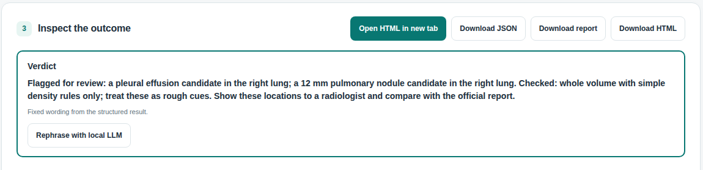

# 🫁 ThoraxBench Local

[](https://github.com/marcelpetrick/ThoraxGPT_from_Wish/actions/workflows/local-pipeline.yml)
[](https://github.com/marcelpetrick/ThoraxGPT_from_Wish/releases/latest)
[](LICENSE)
[](docs/architecture.md)
[](docs/DISCLAIMER.md)
[](docs/manual.html)

**Point it at the DICOM folder of your own chest CT. Get three plain sentences back: what
looks worth a second look, where it is, and what to ask your radiologist. Nothing leaves your
computer.**



## Why this exists

A good friend came home from a chest CT with a CD of images and many questions, and the official
report was still days away. A CT has hundreds of slices, and a viewer alone won't tell you where
to look. ThoraxBench Local is the tool built for that moment:

- **Private.** It runs on your own machine. No upload, no cloud, no telemetry.
- **Whole chest.** The lung-nodule detector reads the entire 3D volume, not a few sampled images.
- **Plain language.** Every result starts with a verdict of at most three sentences, in
  English or German, with the slice number, side and size of anything flagged.
- **Honest.** Each model carries a fit marker based on test runs, and unsupported answers are
  thrown out instead of shown.

> **Not a diagnosis.** This is a self-made experimental research tool. Its findings may be
> wrong, incomplete or misleading. Take every result to a radiologist, and treat their
> report as the reference. [Full disclaimer](docs/DISCLAIMER.md).

## Look through a scan in five steps

You need Python 3.14, [uv](https://docs.astral.sh/uv/getting-started/installation/) and a clone
of this repository. An NVIDIA GPU speeds up the detector but isn't required.

```bash
uv sync --frozen --all-groups --extra detector                             # 1. install
uv run --extra detector python scripts/fetch_monai_bundle.py --accept-terms  # 2. detector weights (read the terms first)
uv run --no-sync python scripts/dcom_evaluator.py --scan-headers --check-import "/path/to/your/DICOM"  # 3. optional: check the folder
uv run --extra detector thoraxbench serve                                  # 4. start
```

5. Open **http://127.0.0.1:8000** and drop the folder path into **Open local DICOM folder**.
   Choose **1️⃣ monai-lung-nodule**, then select **Full thorax review**. You'll see progress
   and the remaining time. When it finishes, read the verdict, open the flagged slices and
   download the HTML report for your doctor's appointment.

Step 2 shows the model's license terms; run it once without `--accept-terms` to read them.
Step 3 prints only counts, never names or header values (see the
[folder checker guide](docs/wiki/Checking-a-real-DICOM-folder.md)). No CT at hand? Select
**Create synthetic demo** for a code-generated phantom.

## Which model should I trust?

| Fit | Model | What it's good for |
|---|---|---|
| 1️⃣ | `monai-lung-nodule` | **Start here.** A 3D detector for lung nodules over the whole volume. In test runs it found the known nodules in both cases that had them, and raised one false alarm (score 0.77) on a nodule-free scan. |
| 2️⃣ | `heuristic-hu` | Rough density rules over the whole volume, such as fluid or air. Useful as weak cues; it over-reports. |
| 2️⃣ | CT-CHAT, CT-CLIP, M3D-LaMed, RadFM | 3D CT models. Thorax-specific, but they need separate setup and are not measured here. |
| 3️⃣ | MedGemma, Qwen, MiniCPM-V, Moondream, Llama Vision | Research controls only. MedGemma answered "absent" for every finding, including known nodules. |

Evidence: [model test runs](docs/model-test-runs-2026-10-20.md). Every test so far is on a
synthetic phantom and two public LIDC calibration cases. **Accuracy on real-world scans has not
been measured.**

## What you get

- **Full thorax review:** the detector and density checks run over the whole chest. An image
  model can optionally sweep every 5 mm slab, coarse to fine. You get live time-per-image and
  remaining-time estimates, a stop button that keeps partial results, and a ranked
  "look here" list. ([details](docs/full-review.md))
- **Reports to bring along:** one offline HTML file with the verdict, candidate images, slice
  numbers and an EN/DE switch. Shareable reports contain no patient ID or series UID.
- **Optional local wording:** a local LLM can rephrase the verdict from the structured facts.
  Any new number, finding or diagnostic word is rejected.
- **Robust import:** real hospital folders with odd vendor header tags open correctly. The
  folder checker tells you up front if something will not.
- **Bilingual and responsive:** English and German, light and dark themes, keyboard and
  screen-reader support, and a layout that works on a phone.

| Analysis with verdict | German, dark theme | Mobile |
|---|---|---|
|  |  |  |

Screenshots show the synthetic phantom, never patient data.

## Built carefully

- Every commit passes a local gate: formatting, linting, strict mypy, more than 1,000 unit,
  integration and browser tests with a ≥95 % coverage gate, a wheel build and a dependency
  audit. CI runs the same pipeline.
- Medical data, rendered real slices and model weights never enter Git. The
  [data policy](docs/DATA_POLICY.md) keeps a 20 % patient-level holdout sealed from all
  development work.
- Each run records its model, prompt, configuration hashes and timings, so it can be repeated
  ([reproducibility](docs/reproducibility.md)).

## Learn more

- [Operator manual](docs/manual.html) ([PDF](docs/manual.pdf)): every screen, step by step
- [Research workflows](docs/research-workflows.md): CLI, model setup, cohorts, benchmarks
- [All documentation](docs/README.md), [release notes](docs/releases/) and
  [security](SECURITY.md)

**Author:** Marcel Petrick <mail@marcelpetrick.it> · **License:** GPLv3 or later, see
[`LICENSE`](LICENSE) · Built with AI assistance.
