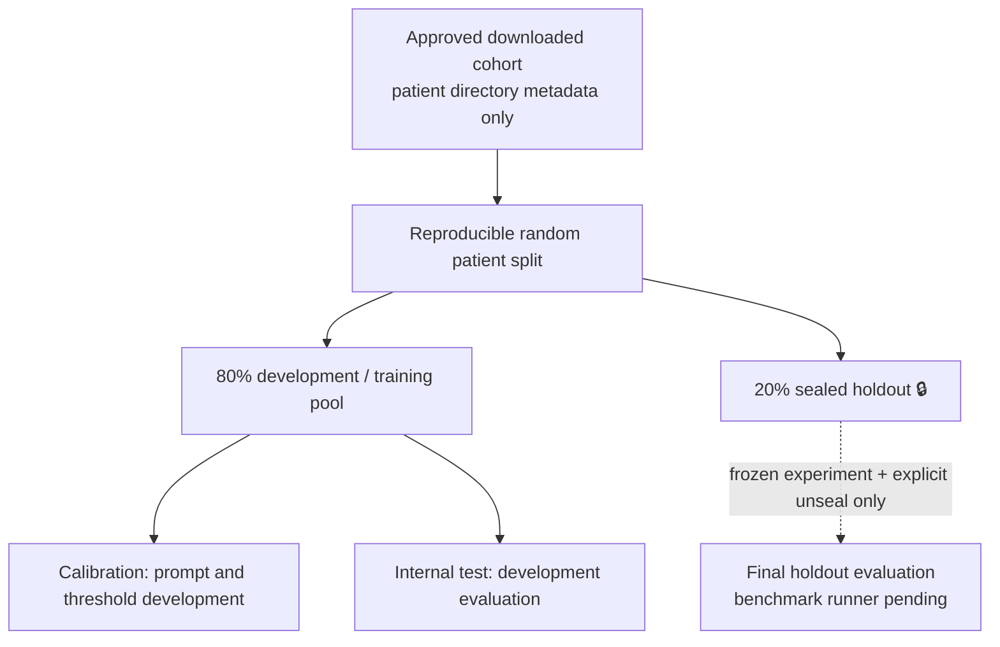

# ThoraxBench Local

[](https://github.com/marcelpetrick/ThoraxGPT_from_Wish/actions/workflows/local-pipeline.yml)
[](LICENSE)
[](https://www.python.org/)

A local-first, license-aware, reproducible thoracic-CT AI benchmark laboratory.
See [`Vision.md`](Vision.md) for the research goals, [`docs/architecture.md`](docs/architecture.md)
for the C4 architecture and [`docs/plan.md`](docs/plan.md) for the
implementation plan. Read the [HTML operator manual](manual.html) or [printable PDF](manual.pdf)
for setup, configuration, a first run and troubleshooting.

> **Research use only.** ThoraxBench Local is not a medical device and its outputs are
> experimental predictions, not medical advice from a qualified healthcare professional.
> This self-made tool uses available models and reference knowledge, but findings may be
> incorrect, incomplete or misleading. Do not use them for diagnosis or treatment decisions.

**Author: Marcel Petrick <mail@marcelpetrick.it>**

**License: GPLv3 or later. See [`LICENSE`](LICENSE).**

**Note: project is generated with AI.**

The local workbench turns a DICOM study into experimental findings and readable research
reports. Use the GUI or CLI; both call the same guarded engine. The synthetic demo works
without an AI server, and vision models use local Ollama.

Start the graphical interface on this workstation, from any directory:

```bash
uv run --project /home/mpetrick/repos/ThoraxGPT_from_Wish thoraxbench serve
```

Open **[http://127.0.0.1:8000](http://127.0.0.1:8000)**, click **Create synthetic demo**, then
**Run analysis locally** with `heuristic-hu`. The viewer, findings table and downloads show
what happened. On another machine, replace the checkout path with yours.

The interface defaults to **English and light mode**; English/German and light/dark switches
persist locally. Actions, labels and metrics have hover/keyboard tooltips. **About** names
Marcel Petrick and lists installed library versions and declared licenses. Design proposals
and acceptance criteria are in [the UI design document](docs/ui.md).


Downloaded cohorts are randomly split **by patient**, reproducibly, before development
analysis. The 80% development pool includes calibration and internal-test subsets. The 20%
**holdout** stays sealed: no development indexing, prompt tuning, calibration or tests.
Only a future frozen benchmark with explicit unsealing may evaluate it.



| Downloaded cohort | Development / training | Sealed holdout |
|---|---:|---:|
| LIDC-IDRI (60 patients) | 48 | 12 |
| NSCLC-Radiogenomics (27 patients) | 22 | 5 |

Whole patients stay together; the 27-patient cohort rounds the holdout to five patients.
Public split manifests contain salted hashes only. Existing splits cannot be overwritten.


The graphic shows the recorded synthetic heuristic run: a right 12 mm nodule (score 0.79)
and right pleural effusion (score 1.00), with 0.465 s in analysis stages, excluding DICOM
loading, report rendering and provenance collection. These uncalibrated scores demonstrate the pipeline; accuracy remains unmeasured.
See the [MVP test record](docs/mvp-test.md) for the exact command and results.
The [model selection and benchmark status](docs/model_selection.md) explains which models
are installed, what was tested, and the planned comparison.

Run these commands from the repository root (Python 3.14 and `uv`). Stay in that
directory after generating the demo; paths are relative to your current directory:

```bash
cd /home/mpetrick/repos/ThoraxGPT_from_Wish  # use your checkout path on another machine
uv sync --frozen --all-groups
uv run thoraxbench demo-data data/demo/mvp
uv run thoraxbench analyze data/demo/mvp --model heuristic-hu \
  --output data/results/demo.json --report data/results/demo.md --html data/results/demo.html
# Local Ollama vision model, already pulled on this workstation:
uv run thoraxbench analyze data/demo/mvp --model medgemma1.5-q4 --n 4 \
  --output data/results/medgemma.json --report data/results/medgemma.md --html data/results/medgemma.html
```

If you already changed into `data/demo/mvp`, use `uv run thoraxbench analyze . --model
heuristic-hu` to print the report, or return to the repository root with `cd ../../..` before
using the export paths above. Generating the demo does not require changing directories.

The generated phantom includes a nodule and fluid-density region. The heuristic demo
exercises DICOM loading, deterministic measurements, parsing and report generation. The
MedGemma run also renders sampled images and sends them to the local vision model.
Neither demo measures accuracy on real patients. HTML export destinations must stay under
the configured `data/results/` directory; paths and symlinks leading outside are rejected.

| Output | What to inspect |
|---|---|
| `data/results/demo.json` | Findings, original model response, QC, timings, hashes and provenance |
| `data/results/demo.md` | Summary, finding explanations and educational guideline context |
| `data/results/demo.html` | Offline review page: findings, educational severity/review context, embedded images and supplied evidence links |
| Terminal output | The same report; failure/abstention returns a nonzero exit status |

`uv run thoraxbench models` checks configured local model availability; `datasets` lists
license statuses. `split <dataset>` creates a frozen patient split from downloaded directory
metadata and refuses to replace it. Real files under `data/raw/` require development
membership; known sealed patient hashes also block copied holdout files.
`index <dataset> --limit 1` builds a development-only index for a quick real-data check.

The synthetic phantom exercises the full DICOM path without patient data. Failed inference,
invalid responses and inadequate studies abstain; inspect saved output for details. Scores
are uncalibrated; educational guideline context is not a patient care plan. Benchmarking and
advanced comparison UI remain pending; see [the current plan](docs/plan.md).

This workstation has the locked Python dependencies, MedGemma Q4/Q8 and qwen3-vl:4b, and
Playwright Chromium. All 8,293 LIDC-IDRI and 4,431 NSCLC-Radiogenomics downloaded files
passed SHA-256 verification on 2026-10-15; checksum manifests and license snapshots match
Git. The editable package metadata was refreshed to match the source version. A real development
study completed the heuristic path. A small live MedGemma transport test completed in about
50 seconds but returned no findings; empty predictions now abstain. The full-label model
run generated excessively long output; generation is capped at 4,096 tokens and truncation
also abstains. Model accuracy remains unmeasured; expect minutes for larger image requests.

A sandbox must permit access to this checkout, the `uv` cache (or package downloads), and
loopback HTTP to the host Ollama server. A separate container's `localhost` refers to that
container, so the host service will not automatically be reachable. Optional 3D services
and gated weights are not installed by the MVP. Playwright Chromium is required for browser
acceptance tests; the CLI uses no browser.

For larger hardware, see the [40 GB VRAM and trusted LAN runner proposal](docs/lan-runner.md).
It is documented for tomorrow; LAN inference is not enabled in this release.
