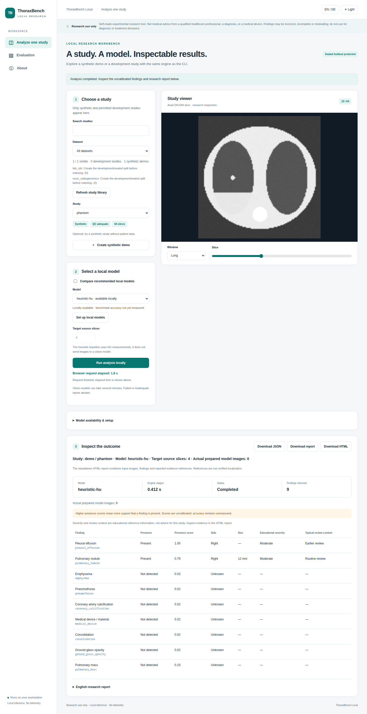
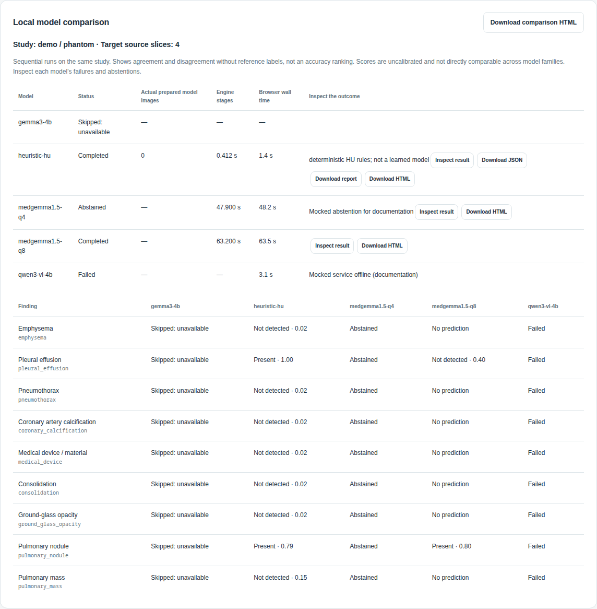
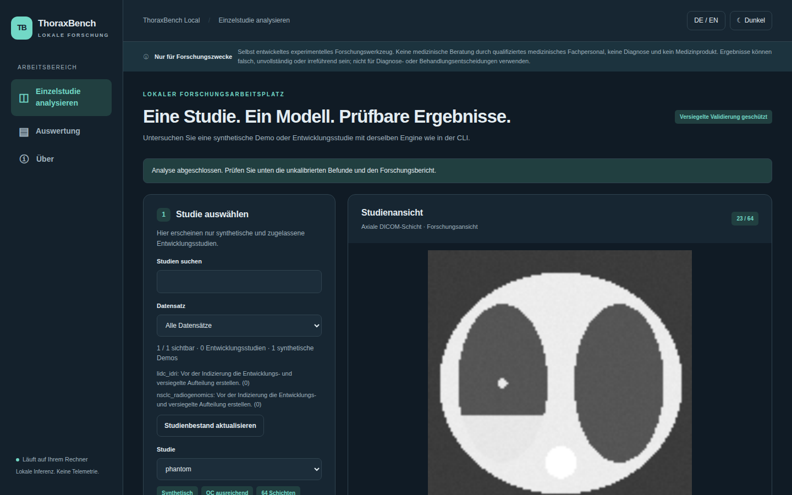
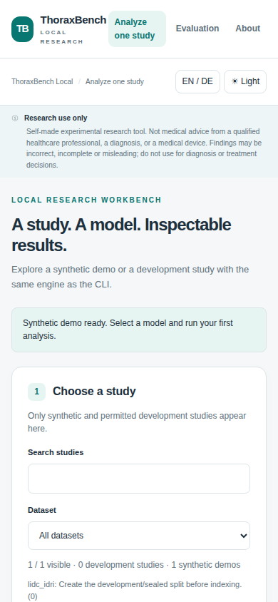
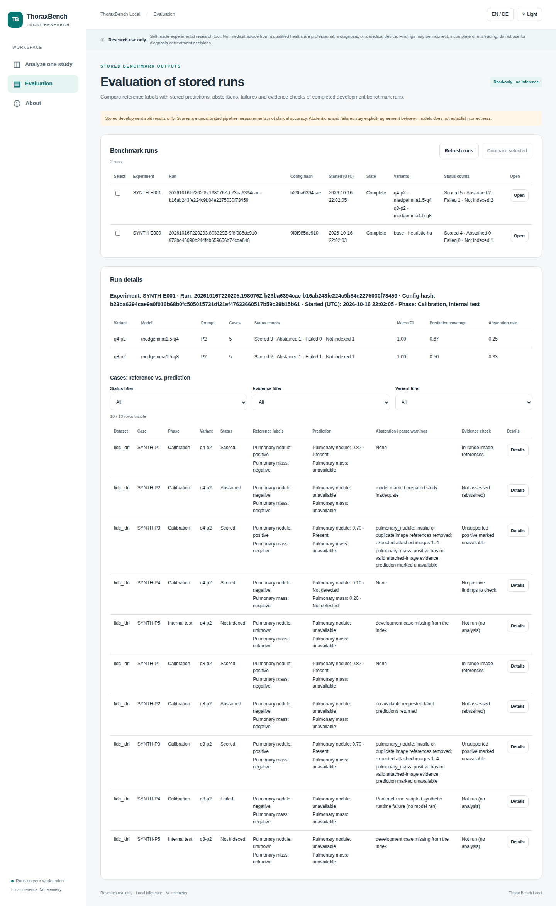
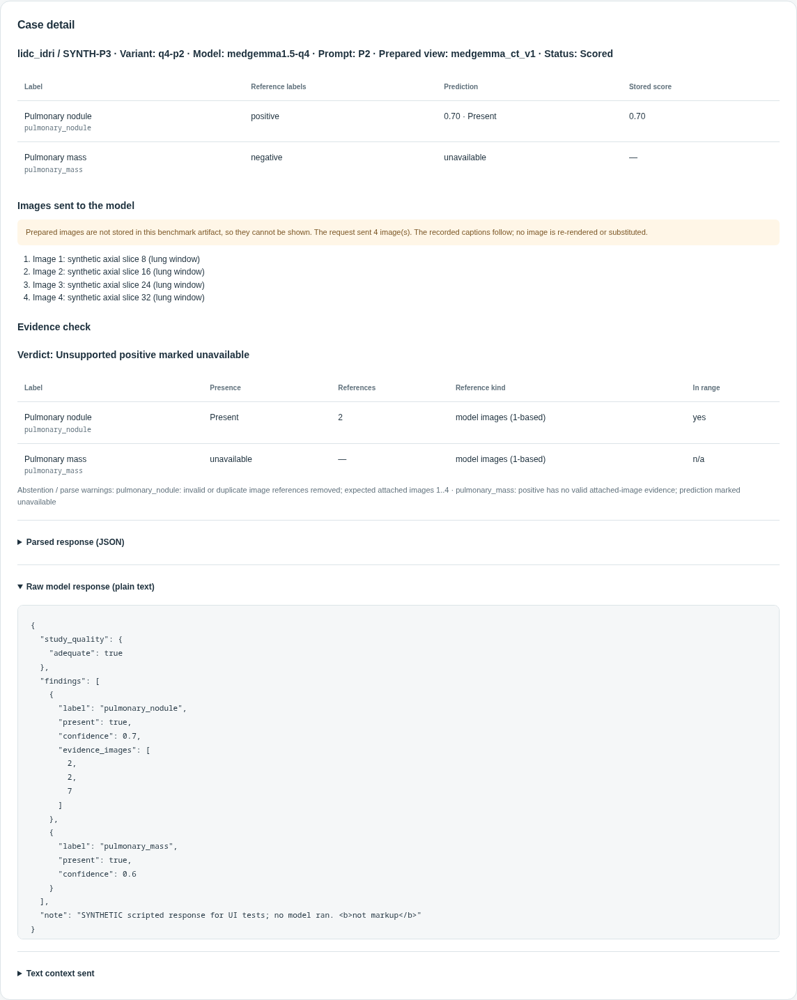
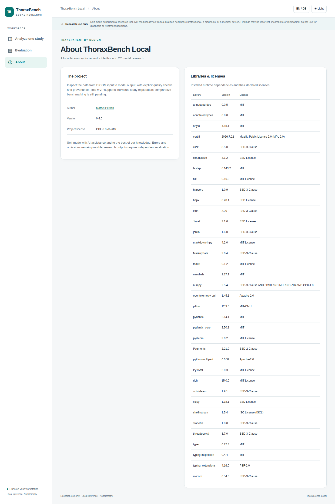
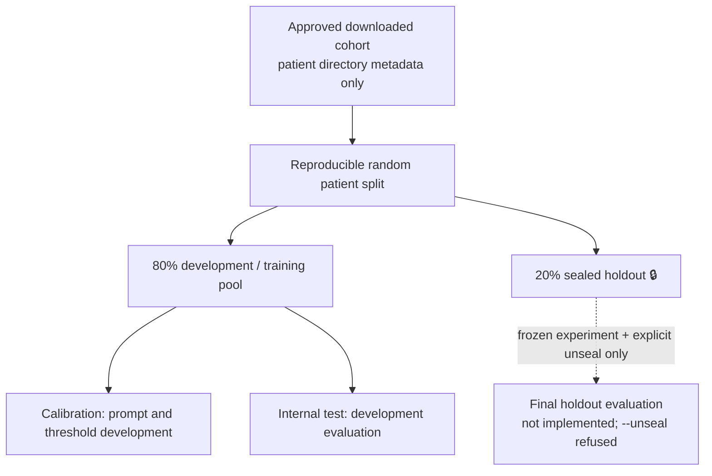
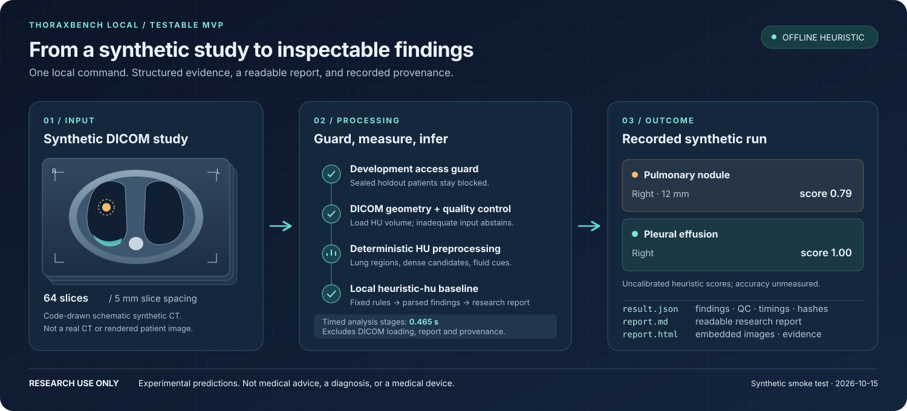

# 🫁 ThoraxBench Local

[](https://github.com/marcelpetrick/ThoraxGPT_from_Wish/actions/workflows/local-pipeline.yml)
[](LICENSE)
[](https://www.python.org/)
[](pyproject.toml)
[](docs/mvp-test.md)
[](pyproject.toml)
[](docs/architecture.md)
[](Vision.md)
[](manual.html)
[](manual.pdf)
[](https://github.com/marcelpetrick/ThoraxGPT_from_Wish/releases/latest)

A local-first, license-aware, reproducible thoracic-CT AI benchmark laboratory.
See [`Vision.md`](Vision.md) for the research goals, [`docs/architecture.md`](docs/architecture.md)
for the C4 architecture and [`docs/plan.md`](docs/plan.md) for the
implementation plan. Read the [HTML operator manual](manual.html) or [printable PDF](manual.pdf)
for setup, configuration, a first run and troubleshooting. The build backend is pinned to
Hatchling 1.32.4; CI uses uv 0.13.1. Runtime, development and locked transitive dependencies
were checked against current stable releases on 2026-10-15.

| Document | Content |
|---|---|
| [`docs/linkedin-video-plan.md`](docs/linkedin-video-plan.md) | Two video pilot scripts, recording readiness and LinkedIn export settings |
| [`docs/ux-review-2026-10-16.md`](docs/ux-review-2026-10-16.md) / [HTML](docs/ux-review-2026-10-16.html) | Ranked UX findings, implementation plan and verification status |
| [`docs/fine-tuning-plan.md`](docs/fine-tuning-plan.md) | Precision limits, ranked adaptation options, leakage-safe fine-tuning protocol |
| [`docs/results.md`](docs/results.md) | Measured benchmark runs with config hash, command and limitations |
| [`docs/reproducibility.md`](docs/reproducibility.md) | What each run records, pinned software, how to repeat a run |
| [`DATA_POLICY.md`](DATA_POLICY.md) | Medical-data rules, license gate, data budget, sealed holdout |
| [`SECURITY.md`](SECURITY.md) | Implemented controls, known gaps, vulnerability reporting |
| [`docs/vision_traceability.md`](docs/vision_traceability.md) | Vision section → implementation status and evidence |
| [`docs/datasets.md`](docs/datasets.md) | Dataset license research and the `acquire` procedure |

> **Research use only.** ThoraxBench Local is not a medical device and its outputs are
> experimental predictions, not medical advice from a qualified healthcare professional.
> This self-made tool uses available models and reference knowledge, but findings may be
> incorrect, incomplete or misleading. Do not use them for diagnosis or treatment decisions.

**Author: Marcel Petrick <mail@marcelpetrick.it>**

**License: GPLv3 or later. See [`LICENSE`](LICENSE).**

**Note: project is generated with AI.**

The local workbench turns a DICOM study into experimental findings and readable research
reports. Use the GUI or CLI; both call the same guarded engine. The synthetic demo works
without an AI server, and vision models use local Ollama.

## Screenshots

All screenshots show the code-generated synthetic phantom, not patient data. Vision-model
outputs and model-download states are mocked. Evaluation screenshots read synthetic benchmark
runs whose vision outputs are scripted (no model ran). Engine timings and browser waits are fixed
illustrative values, not benchmark measurements. Regenerate them with
`uv run python scripts/capture_screenshots.py` (see `scripts/README.md`).

| Analysis result (heuristic baseline) | Local model comparison |
|---|---|
|  |  |
| **German, dark theme** | **Mobile** |
|  |  |
| **Evaluation of stored runs** | **Evaluation case detail** |
|  |  |

## First browser run

Prerequisites: Python 3.14, [uv](https://docs.astral.sh/uv/getting-started/installation/),
and a source checkout. Use your checkout path on another machine.

1. Open the repository directory.

   ```bash
   cd /home/mpetrick/repos/ThoraxGPT_from_Wish
   ```

2. Install the locked environment.

   ```bash
   uv sync --frozen --all-groups
   ```

3. Start the server.

   ```bash
   uv run thoraxbench serve
   ```

4. Open **[http://127.0.0.1:8000](http://127.0.0.1:8000)** on the same computer.
5. Select **Create synthetic demo**.
6. Select the `heuristic-hu` model.
7. Select **Run analysis locally**.
8. Inspect the result status before reading the findings.
9. Select **Download HTML** to save the offline report.

**Checkpoint:** the viewer shows a synthetic study. The baseline returns experimental
nodule and effusion findings. The downloaded HTML opens without the server.
No model server is needed for this demo.

**Recovery:** if port 8000 is occupied, run `uv run thoraxbench serve --port 8001` and open
`http://127.0.0.1:8001`. If the engine fails or abstains, read the error and saved report.
Do not interpret failure as a negative finding. Press Ctrl+C in the server terminal to stop.
Restart an existing server after an upgrade.

To start from another directory after installation, use
`uv run --project /path/to/checkout thoraxbench serve`.

The **Rough remaining estimate** starts with broad workstation guesses: 1–60 seconds for
the HU baseline and 1–15+ minutes for a vision model. Later estimates use recent local
request durations for the same model and image count. They are not measured benchmarks,
inference progress or deadlines. Hardware, input size and cold loading can exceed them.
Only numeric duration history is stored locally; no study identifiers are used.

The live **Browser request elapsed** timer measures waiting time. **Current model elapsed**
times the active model in a comparison. **Engine stages** records processing time separately.
**Batch progress** shows model position, not inference percent.

To compare model outputs:

1. Enable **Compare recommended local models**.
2. Select **Compare local models**.
3. Inspect each model's status and findings.
4. Open individual downloads to inspect each model's evidence.
5. Select **Download comparison HTML** for one offline review file.

**Checkpoint:** available recommended models run one at a time. Unavailable models are
skipped. Failures and abstentions remain visible beside completed runs. Scores are
uncalibrated and are not directly comparable across models. Agreement does not establish
accuracy. The combined export uses existing results; it starts no additional inference.

The interface defaults to **English and light mode**; English/German and light/dark switches
persist locally. Actions, labels and metrics have hover/keyboard tooltips. **About** names
Marcel Petrick and lists installed library versions and declared licenses. Design proposals
and acceptance criteria are in [the UI design document](docs/ui.md).



Downloaded cohorts are randomly split **by patient**, reproducibly, before development
analysis. The 80% development pool includes calibration and internal-test subsets. The 20%
**holdout** stays sealed: no development indexing, prompt tuning, calibration or tests.
No current command evaluates it: `thoraxbench benchmark --unseal` is refused (exit status 2)
until a frozen-config sealed-evaluation workflow is implemented and reviewed.



| Downloaded cohort | Development / training | Sealed holdout |
|---|---:|---:|
| LIDC-IDRI (60 patients) | 48 | 12 |
| NSCLC-Radiogenomics (27 patients) | 22 | 5 |

Whole patients stay together; the 27-patient cohort rounds the holdout to five patients.
Public split manifests contain salted hashes only. Existing splits cannot be overwritten.



The graphic shows the recorded synthetic heuristic run: a right 12 mm nodule (score 0.79)
and right pleural effusion (score 1.00), with 0.465 s in analysis stages, excluding DICOM
loading, report rendering and provenance collection. These uncalibrated scores demonstrate the pipeline; accuracy remains unmeasured.
See the [MVP test record](docs/mvp-test.md) for the exact command and results.
The [model selection and benchmark status](docs/model_selection.md) explains which models
are installed, what was tested, and the planned comparison. Measured development-split
benchmark runs are in [`docs/results.md`](docs/results.md).

## Repeat the run from the CLI

Start in the repository root with the locked environment installed. Keep that working
directory for all steps. All paths below are relative to it.

1. Create the synthetic study.

   ```bash
   uv run thoraxbench demo-data data/demo/mvp
   ```

2. Run the baseline and save its artifacts.

   ```bash
   uv run thoraxbench analyze data/demo/mvp --model heuristic-hu \
     --output data/results/demo.json --report data/results/demo.md --html data/results/demo.html
   ```

3. Open `data/results/demo.html` in a browser.

**Checkpoint:** the command returns exit status 0 and creates JSON, Markdown and HTML.
A failed run or abstention returns a nonzero status. Inspect any saved artifacts for the
reason; errors before result creation may produce only a terminal message.

For an optional vision run, first check availability:

```bash
uv run thoraxbench models
```

If `medgemma1.5-q4` is available, run:

```bash
uv run thoraxbench analyze data/demo/mvp --model medgemma1.5-q4 --n 4 \
  --output data/results/medgemma.json --report data/results/medgemma.md --html data/results/medgemma.html
```

**Recovery:** if the model is unavailable, inspect the configured Ollama tag and local
service. Use the heuristic demo while resolving model setup. Do not switch to cloud
inference or bypass the loopback guard.

If you already changed into `data/demo/mvp`, use `uv run thoraxbench analyze . --model
heuristic-hu` to print the report, or return to the repository root with `cd ../../..` before
using the export paths above. Generating the demo does not require changing directories.

The generated phantom includes a nodule and fluid-density region. The heuristic demo
exercises DICOM loading, deterministic measurements, parsing and report generation. The
MedGemma run also renders sampled images and sends them to the local vision model.
Neither demo measures accuracy on real patients. HTML export destinations must stay under
the configured `data/results/` directory; paths and symlinks leading outside are rejected.

| Output | What to inspect |
|---|---|
| `data/results/demo.json` | Findings, original model response, QC, timings, hashes and provenance |
| `data/results/demo.md` | Summary, finding explanations and educational guideline context |
| `data/results/demo.html` | Offline review page: findings, educational severity/review context, embedded images and supplied evidence links |
| Terminal output | The same report; failure/abstention returns a nonzero exit status |

## Set up an unavailable model

The built-in `heuristic-hu` needs no download. For Ollama, the normal CLI workflow
works: `ollama run` downloads a missing tag and starts an interactive session.

Prerequisites: installed local Ollama, enough disk space, and permission under the
publisher's terms. Use the exact `tag` in `configs/models/`, not the app's model ID.
For example, app ID `medgemma1.5-q4` uses this tag. Run from the repository root:

```bash
ollama run medgemma1.5:4b-it-q4_K_M
```

1. Wait for the download and interactive prompt.
2. Enter `/bye` to leave the chat.
3. Run `ollama list`.
4. Select **Refresh model availability** in the workbench.

For download only, use `ollama pull medgemma1.5:4b-it-q4_K_M` instead. If the server
is not running, start your installed Ollama service or run `ollama serve` in another
terminal. Keep the service on loopback. See [Ollama's CLI reference](https://docs.ollama.com/cli).

**Checkpoint:** the exact configured tag appears locally and the UI reports it available.
Ollama stores weights in its own model store, outside `data/`. Availability does not
establish GPU capacity or useful findings. Analysis in this app does not auto-download.

The optional browser alternative is **Model availability & setup** → **Model terms** →
terms acknowledgement → **Download model weights**. Wait for **Download finished**, then
confirm availability. **Active layer bytes** can reset between layers; it is not a
whole-model percentage. Analysis/setup controls lock during this explicit UI download.

**Recovery:** inspect download errors and check the exact tag, terms/access, network,
disk space and local service. Retry explicitly. The app has no cancel endpoint; closing
the page does not confirm cancellation.

For an optional HTTP service, read its provider links and **Provider configuration
(English)**. Obtain upstream approval and permitted weights first. Check hardware and
runtime dependencies. Start the compatible service at its configured loopback URL, then
select **Refresh model availability**. The app does not install these services, supply
credentials, or bypass gated access.

## Commands

Run every command from the repository root. `uv run thoraxbench <command> --help` shows the
current options.

| Command | Purpose |
|---|---|
| `info` | Print the intended-use statement |
| `serve [--port N]` | Start the browser workbench on `127.0.0.1` |
| `demo-data DIR` | Write a synthetic chest-CT phantom (no patient data) |
| `analyze DIR` | Analyse one permitted DICOM study with one local model |
| `models` | List configured models and local availability |
| `datasets` | List registered data sources and their license status |
| `acquire DATASET` | Download an approved TCIA collection with license, budget, split and checksum gates |
| `split DATASET` | Freeze the 80 % development / 20 % sealed patient split |
| `index DATASET` | Index development studies and reference labels |
| `privacy audit DIR` | Report DICOM header identifiers by tag keyword and count, never values |
| `benchmark EXPERIMENT` | Score a model setup against reference labels of development cases |

## Before using a downloaded research cohort

Prerequisite: the dataset has `status: approved*` in `configs/datasets/<id>.yaml`.

1. Inspect the license status.

   ```bash
   uv run thoraxbench datasets
   ```

2. Download the cohort with `thoraxbench acquire`. Follow the full procedure in
   [`docs/datasets.md`](docs/datasets.md#acquire-an-approved-dataset). Start with
   `--dry-run` to see the plan and the data-budget verdict.
3. Freeze the patient split. Replace the registry ID for another cohort.

   ```bash
   uv run thoraxbench split lidc_idri
   ```

4. Check the reported development and holdout counts.
5. Index one permitted development case.

   ```bash
   uv run thoraxbench index lidc_idri --limit 1
   ```

**Checkpoint:** the split is frozen before indexing or analysis. Existing splits refuse
replacement; keep them. Real files under `data/raw/` require development membership.
Known sealed hashes also block copied holdout files. A guard rejection is intentional;
never bypass it. After a split exists, `acquire` refuses new patients, and
`acquire --verify` re-hashes development patients only.

**Recovery:** `Acquisition refused` (exit status 2) means a license, split or budget gate
failed. Fix the registry entry or the plan; never edit a status to pass the gate.

### Audit DICOM headers

```bash
uv run thoraxbench privacy audit data/demo/mvp
```

**Checkpoint:** the synthetic phantom reports `FAIL` for `PatientName` (a synthetic name)
plus three `review` items. Header values are never printed. Add `--json` for machine-readable
output and `--strict` to exit with status 1 on a `fail` item. The audit checks a subset of
the DICOM PS3.15 Basic Profile; it does not inspect pixel data or prove anonymity.

### Run a development benchmark

Prerequisite: the datasets named in the experiment are split and indexed.

1. Run a quick check on a few cases per dataset.

   ```bash
   uv run thoraxbench benchmark configs/experiments/E000_heuristic_hu_baseline.yaml --limit 2
   ```

2. Run the full experiment without `--limit`.
3. Save the printed `Invocation:` path. Before inference, it contains the immutable
   manifest and atomic checkpoint; each terminal case/variant adds its own raw-response/
   request/provenance artifact under `cases/` (no prepared image bytes). Ollama diagnostics
   include redacted rendered text, actual settings and decoded provider responses;
   malformed response text is bounded. Optional HTTP-service diagnostics remain limited.
4. Open the printed `Report:` path when the run finishes. Each invocation has its own
   timestamp/hash/UUID directory under `data/results/benchmark/<experiment-id>/`.
   Earlier runs remain intact.

To continue an interrupted new-format run, use the same experiment and limit with
`--resume <printed-invocation-directory>`. Resume validates code/configuration, data,
index/split, model/prompt settings and runtime identity. It reuses all checkpointed terminal
outcomes, including failures and abstentions, and runs only pending units. A complete run
returns its existing files. Changed identity, corrupt artifacts or legacy runs without
checkpoints refuse reuse; start a new invocation. See [resume and recovery](docs/benchmarking.md#6-resume-an-interrupted-invocation).

**Checkpoint:** the command prints per-variant status counts, the result and report paths
and the config SHA-256. It reads development cases only. Failures and abstentions stay
explicit per case. E000 is a pipeline baseline of a deterministic HU heuristic, not model
accuracy; see [`docs/results.md`](docs/results.md). `configs/experiments/` also holds the
MedGemma experiments E001–E004; they need local Ollama. See [the benchmark guide](docs/benchmarking.md).
The separate `E001_calibration_smoke.yaml` uses four 256-pixel axial inputs, Q4/Q8 only,
and calibration cases. Run it with `--limit 1` before considering the larger sweeps. It is
a readiness check, not the full E001 experiment or an accuracy estimate. The first run
completed in 290.8 s: Q4 abstained on both studies; Q8 scored one response (missed the
reference nodule) and hit its generation limit on the other. See [recorded results](docs/results.md#e001-smoke--calibration-only-medgemma-readiness-2026-10-16).

**Recovery:** `Benchmark failed` (exit status 1) names the cause, for example a missing
index or split. `--unseal` is refused with exit status 2; the sealed holdout stays untouched.

To inspect a finished run in the browser, start `uv run thoraxbench serve` and select
**Evaluation**. It lists the runs, compares setups descriptively, and shows per-case
reference labels next to stored predictions, warnings and evidence checks. It is read-only:
it never starts inference or reads sealed cases. Prepared images are not stored in benchmark
artifacts; the case detail shows the recorded image count instead. See [the Evaluation
procedure](docs/ui.md#review-stored-benchmark-runs-evaluation).

The synthetic phantom exercises the full DICOM path without patient data. Failed inference,
invalid responses and inadequate studies abstain; inspect saved output for details. Scores
are uncalibrated; educational guideline context is not a patient care plan. Sealed-holdout
evaluation and calibrated scores remain open; stored runs are reviewable with
`thoraxbench compare` and the read-only **Evaluation** view;
see [the current plan](docs/plan.md).

This workstation has the locked Python dependencies, MedGemma Q4/Q8 and qwen3-vl:4b, and
Playwright Chromium. All 8,293 LIDC-IDRI and 4,431 NSCLC-Radiogenomics downloaded files
passed SHA-256 verification on 2026-10-15; checksum manifests and license snapshots match
Git. The editable package metadata was refreshed to match the source version. A real development
study completed the heuristic path. A small live MedGemma transport test completed in about
50 seconds but returned no findings; empty predictions now abstain. The full-label model
run generated excessively long output; generation is capped at 4,096 tokens and truncation
also abstains. Model accuracy remains unmeasured; expect minutes for larger image requests.

A sandbox must permit access to this checkout, the `uv` cache (or package downloads), and
loopback HTTP to the host Ollama server. A separate container's `localhost` refers to that
container, so the host service will not automatically be reachable. Optional 3D services
and gated weights are not installed by the MVP. Playwright Chromium is required for browser
acceptance tests; the CLI uses no browser.

For larger hardware, see the [40 GB VRAM and trusted LAN runner proposal](docs/lan-runner.md).
It is documented for tomorrow; LAN inference is not enabled in this release.

GitHub Actions run the complete local pipeline on pushes and pull requests. A passing build
is a software check, not an accuracy benchmark. Public source releases are published
manually on GitHub with the HTML/PDF manuals.
There is no automated release or package-publication workflow. Use the source-checkout
installation above; the wheel is not a standalone configured application. The coverage
badge records the 2026-10-15 integrated test run;
its evidence and limitations are in the [MVP test record](docs/mvp-test.md).

Current scoring treats missing confidence and uncertain presence as unavailable. Task E
reports coverage and omissions; Task G records its eligible-study denominator. Prompt
captions are one-based. Historical aggregate results retain their original definitions.

## Inspect evidence before scoring visual predictions

Constrained local vision prompts (P2–P4) use one-based attached-image references. New analysis
removes invalid/duplicate references and marks a positive without valid attached evidence
unavailable. Raw provider responses stay intact for audit. In-range citations still do not
prove that a finding is visible or correct. P0/P1 unconstrained controls retain their own
semantics. The deterministic HU baseline keeps zero-based source-slice illustrations.

For a controlled readiness check, use `configs/experiments/E001_cue_ablation.yaml` with
`--limit 1`. The two variants share prepared images and differ only in heuristic prompt
context (`include_cues: true` / `false`). Do not tune on internal-test or sealed cases.
This configuration is calibration-only and does not establish detection accuracy.

Evidence eligibility uses the shared implied presence probability at the default 0.5
cutoff, including low-confidence absent verdicts that imply a positive probability.
`include_cues` accepts only YAML booleans; null, numbers and strings are refused.
