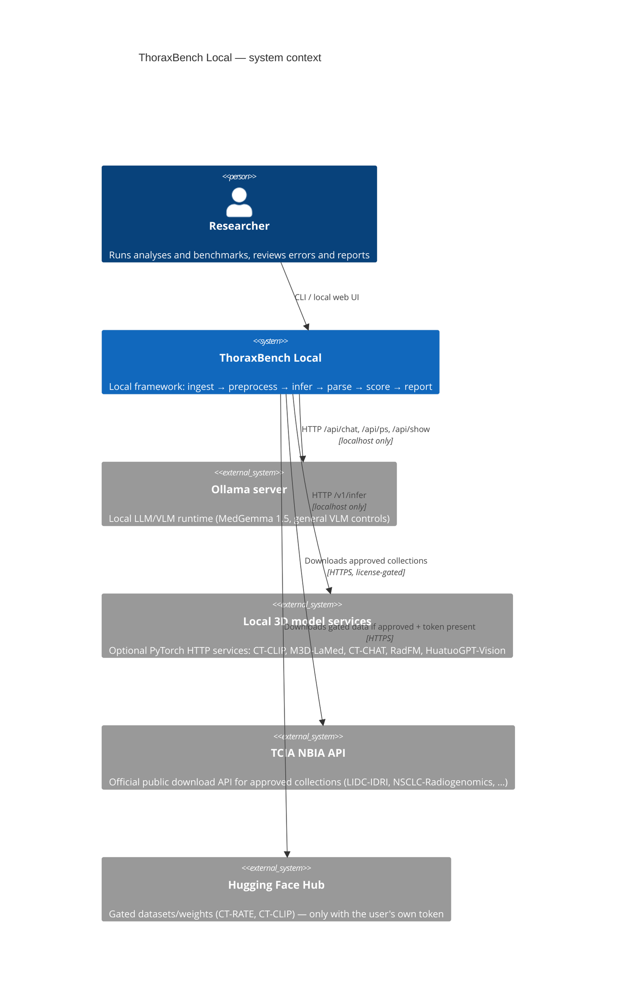
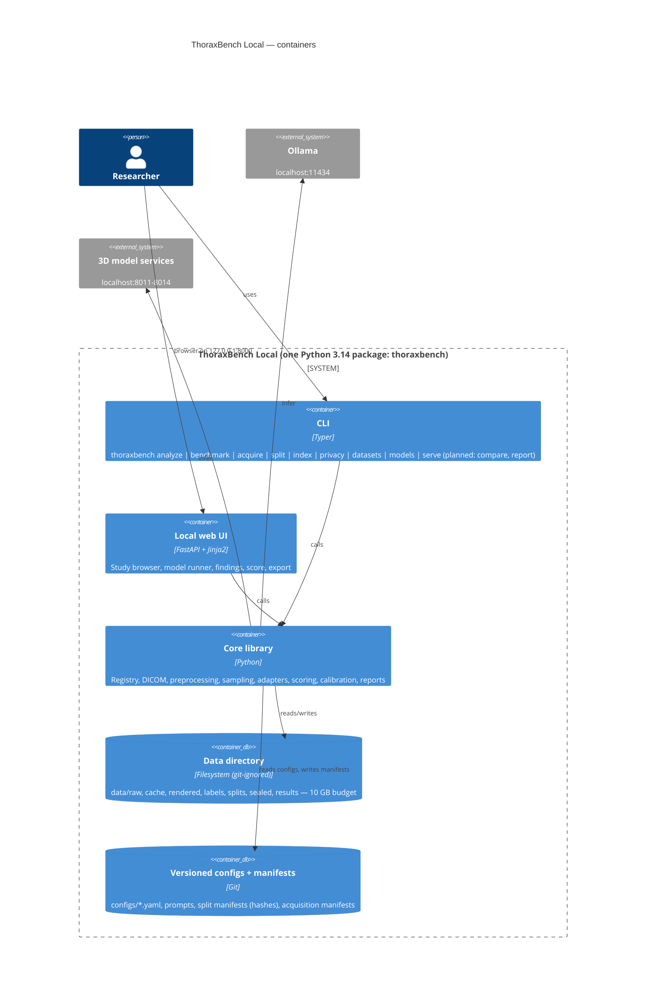
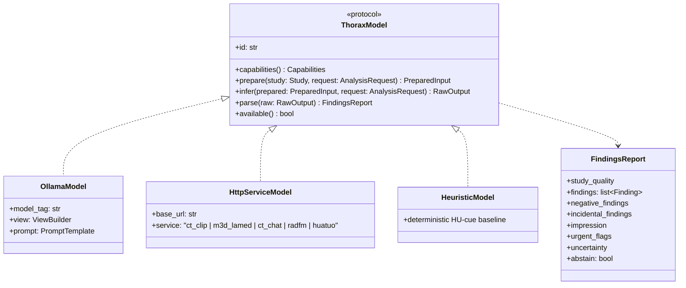
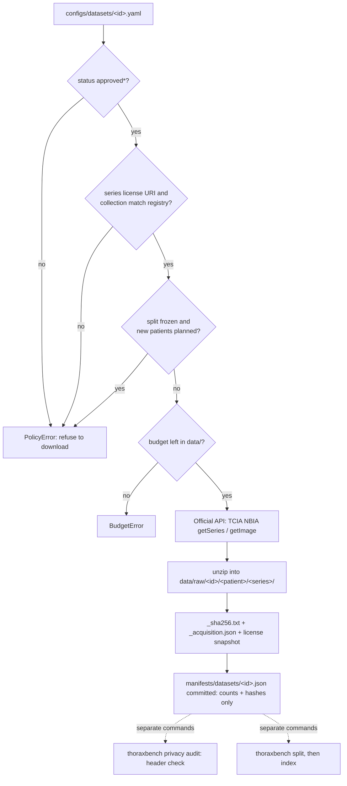
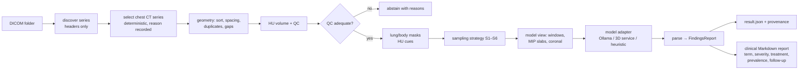
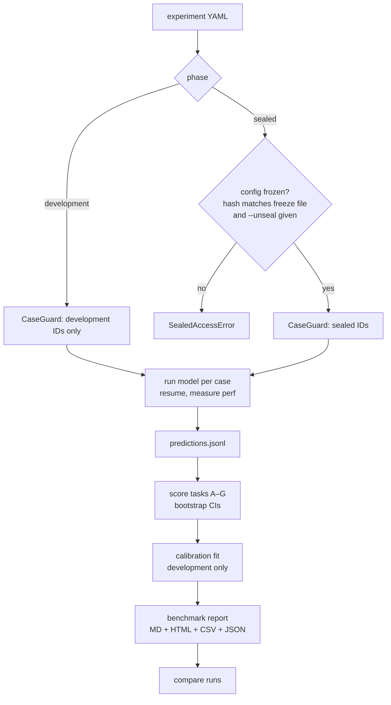
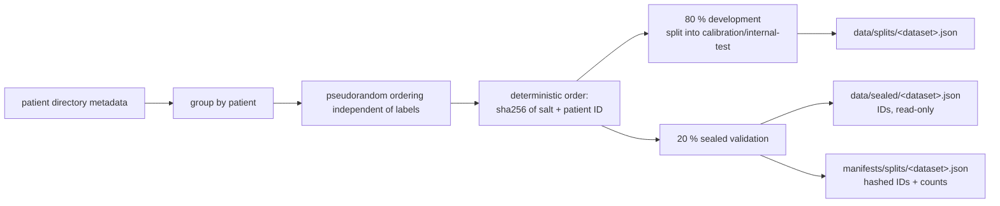
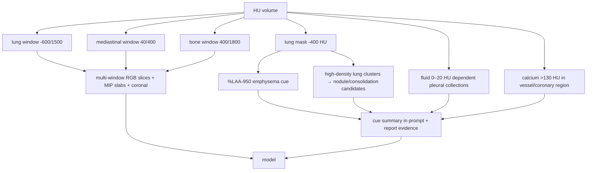
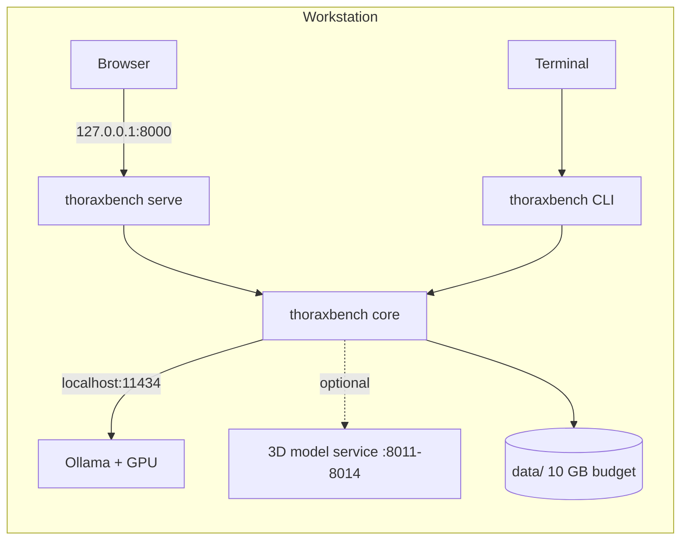

# ThoraxBench Local — Architecture

This document describes ThoraxBench Local with the [C4 model](https://c4model.com/)
(Context → Containers → Components → Code) plus flowcharts for the main workflows.
Diagrams are Mermaid, so GitHub renders them directly.

Source of requirements: [`Vision.md`](../Vision.md). Section references (§) point there.

> Research use only. This self-made experimental tool is not professional medical advice.
> Findings may be incorrect, incomplete or misleading. Do not use outputs for diagnosis or
> treatment decisions.

## Read the diagrams against current scope

The diagrams include target architecture. A drawn component does not establish that its
CLI command is implemented. Current commands are `acquire`, `split`, `index`, `analyze`,
`benchmark`, `privacy audit`, `demo-data`, `datasets`, `models`, `serve`, `info` and
`--version`. Use `uv run thoraxbench --help` from the repository root to check the installed
interface. `benchmark` scores development cases only; `benchmark --unseal` is refused.
Sealed evaluation, an experiment-freeze command, CLI `compare`, calibrated scores and the
HTML/CSV benchmark report remain open. The *Status* column below marks each module.

1. Read `docs/plan.md` for the active work package.
2. Locate the affected component below.
3. Check its implemented contract in `src/thoraxbench/`.
4. Preserve the split, endpoint and output-path guards.
5. Run `./localPipeline.sh --fast` while iterating.
6. Run the full gate through `scripts/commit.sh` before committing.

**Checkpoint:** CLI and API call the same core guards and analysis functions. If a proposed
path bypasses a guard, reject that design rather than weakening the guard.
**Recovery:** inspect `.pipeline/<stage>.log` after a failed gate and fix the cause.

The pilot uses metadata-only pseudorandom patient splits before development indexing.
The stratified split design below remains a future research option, not the pilot procedure.

---

## 1. System context (C4 level 1)

CT pixels, rendered images, predictions and labels stay on the workstation. Inference uses
only loopback services. Outbound setup/acquisition can obtain approved datasets, documentation,
source packages, model weights and metadata (§2.1, §29). It must not send study data.

---

## 2. Containers (C4 level 2)

---

## 3. Components (C4 level 3) — the `thoraxbench` package

```mermaid
C4Component
    title thoraxbench core library — components

    Container_Boundary(core, "thoraxbench") {
        Component(config, "config", "pydantic-settings style", "Paths, endpoints, budget; env THORAXBENCH_*")
        Component(registry, "registry", "YAML + pydantic", "Dataset/model registry, license status, policy gate")
        Component(ingest, "acquisition", "httpx", "Source-specific acquisition (TCIA), checksums, manifests, budget")
        Component(dicom, "dicom", "pydicom + numpy", "Series discovery/selection, geometry, HU volume, QC")
        Component(preprocess, "preprocess", "numpy/scipy", "Windows, masks, MIP/coronal, deterministic HU cues")
        Component(sampling, "sampling", "numpy", "S1–S6 slice-selection strategies (versioned)")
        Component(views, "views", "Pillow/numpy", "Model-specific inputs: medgemma_ct_v1, generic_multislice_v1, ct_clip_v1, m3d_lamed_v1")
        Component(prompts, "prompts", "YAML templates", "P0–P4, versioned + hashed")
        Component(adapters, "adapters", "httpx", "ThoraxModel interface: Ollama, HTTP 3D service, HU-heuristic baseline")
        Component(parsing, "parsing", "pydantic", "Robust JSON extraction → FindingsReport")
        Component(ontology, "ontology", "YAML", "Canonical labels, dataset mappings, clinical knowledge base")
        Component(labels, "labels", "xml/csv", "Reference labels per dataset (e.g. LIDC XML)")
        Component(splits, "splits", "hashlib", "Patient-level stratified 80/20 split, sealing guard")
        Component(scoring, "scoring", "numpy/sklearn", "Tasks A–G metrics, bootstrap CIs, FROC")
        Component(calibration, "calibration", "sklearn", "Thresholds, temperature, isotonic, abstention")
        Component(perf, "perf + provenance", "psutil/nvidia-smi", "Latency/VRAM/RAM, hashes, git commit, hardware")
        Component(benchmark, "benchmark", "Python", "Experiment runner on the development split, scoring, Markdown report")
        Component(reports, "reports", "Jinja2/Markdown", "Benchmark report + per-study clinical Markdown report")
    }

    Rel(ingest, registry, "checks status before any download")
    Rel(dicom, preprocess, "HU volume")
    Rel(preprocess, sampling, "masks + cues")
    Rel(sampling, views, "slice indices")
    Rel(views, adapters, "prepared input")
    Rel(prompts, adapters, "prompt text")
    Rel(adapters, parsing, "raw output")
    Rel(parsing, scoring, "FindingsReport")
    Rel(labels, scoring, "ground truth")
    Rel(splits, benchmark, "allowed case IDs")
    Rel(benchmark, scoring, "predictions")
    Rel(scoring, reports, "metrics")
    Rel(ontology, reports, "clinical knowledge")
```

### Component responsibilities and contracts

Status: ✅ implemented, 🔄 partly implemented. Some function names describe the target
contract; check `src/thoraxbench/` for the exact current names.

| Module | Key types / functions | Status | Notes |
|---|---|---|---|
| `study_access` | `guard_study_input(path, settings)` | ✅ | Shared core input guard used by CLI and API; never import a private CLI helper into the API |
| `config` | `Settings` (`data_dir`, `ollama_url`, `data_budget_bytes`, `services`) | ✅ | env prefix `THORAXBENCH_` |
| `registry` | `DatasetEntry`, `DatasetStatus`, `load_registry()`, `require_acquirable(entry)` → `PolicyError` | ✅ | statuses from §6 plus `pending_access` |
| `acquisition` | `acquire(dataset, settings, options)`, `build_plan()`, `BudgetError`, manifest and checksum helpers | ✅ | NBIA REST only; license, split and budget gates; resumable; raw data immutable; `--verify` hashes development patients only |
| `privacy` | `audit_study_dir()`, `Redactor`, `settings_redactor()` | ✅ | header audit and output redaction; see §9 |
| `dicom` | `discover_series(root)`, `select_series()`, `load_volume(series)` → `Volume` | ✅ | `Volume.hu: int16[z,y,x]`, `spacing_mm`, `qc` |
| `preprocess` | `apply_window()`, `lung_mask()`, `body_mask()`, `mip_slab()`, `coronal()`, `hu_cues(volume)` | ✅ | canonical HU never altered (§9.3) |
| `sampling` | `SamplingStrategy` (`id`, `version`, `select(volume, cues) -> list[int]`), S1–S6 | ✅ | deterministic; seed recorded if used |
| `views` | `ViewBuilder.build(volume, indices) -> PreparedInput` | ✅ | `PreparedInput.images: list[bytes]`, `meta` |
| `prompts` | `PromptTemplate` (`id`, `version`, `sha256`, `render(labels, n_images)`) | ✅ | P0–P4 |
| `adapters` | `ThoraxModel` protocol: `prepare`, `infer`, `parse`, `capabilities` (§17) | 🔄 | `OllamaModel`, `HttpServiceModel`, `HeuristicModel`; no 3D service ships with the repository |
| `parsing` | `extract_json(text)`, `parse_findings(raw, ontology)` → `FindingsReport` | ✅ | never invents findings; invalid → abstain |
| `ontology` | `Label`, `ONTOLOGY`, `map_native(dataset, term)`, `ClinicalKB` | ✅ | mapping back to native terms (§12) |
| `labels` | `lidc_reference()`, `nsclc_reference()` → `ReferenceLabels` | ✅ | LIDC XML (nodules, size, reader count) and NSCLC segmentation loaders |
| `splits` | `make_split()`, `SplitManifest`, `CaseGuard`, `freeze_experiment()` → `SealedAccessError` | 🔄 | patient-level, deterministic hash; the pilot uses one stratum; freezing is not exposed in the CLI |
| `scoring` | `task_a()`…`task_g()`, `bootstrap_ci()`, `froc()` | 🔄 | patient-level bootstrap; the benchmark uses tasks A, B, E and G |
| `calibration` | `fit_thresholds()`, `TemperatureScaler`, `IsotonicCalibrator`, `abstention_curve()` | 🔄 | library only; no calibrator is fitted in a benchmark yet; fitted only on development data |
| `perf`, `provenance` | `measure()` context manager, `RunProvenance` | ✅ | §21, §24 |
| `benchmark` | `load_experiment()`, `run_experiment()`, `write_outputs()` | 🔄 | development split only; writes immutable terminal artifacts and atomic checkpoints plus final JSON/Markdown in a unique invocation; strict `--resume`; `compare_runs()` planned |
| `reports` | `render_study_report()`, `render_html_report()`, `render_comparison_report()` | 🔄 | per-study Markdown/HTML; HTML/CSV benchmark report planned |

---

## 4. Code level (C4 level 4) — the adapter interface

---

## 5. Flowcharts

### 5.1 Acquisition (§8)

### 5.2 Single-study analysis (`thoraxbench analyze`, §18)

### 5.3 Benchmark with sealed validation (§14–§16)

Implemented today: the development branch, per-case analysis, scoring of tasks A, B, E and G
with bootstrap CIs, and `result.json` plus `report.md`. Every invocation creates a unique
`data/results/benchmark/<experiment-id>/<timestamp>-<hashprefix>-<uuid>/` folder. The hash
prefix is the first 12 characters of the experiment file SHA-256; the timestamp is UTC.
Existing run directories and legacy flat outputs remain intact. The CLI prints `Invocation:`
after preflight and before inference, then final result/report paths on completion.

`benchmark.checkpoint.BenchmarkStore` owns the invocation. It writes an immutable identity
manifest, an atomic progress checkpoint, and immutable terminal artifacts per case/variant.
Artifacts retain the structured request, resolved spec, outcome, report and serialized
analysis when available, including raw output/provenance but excluding prepared image bytes.
The checkpoint links artifacts by checksum. A write failure stops subsequent inference.

For Ollama, `raw_meta.requests` records rendered system/user messages and actual
model/options/format/schema/keep-alive/thinking settings. Image bytes are omitted and
replaced by image SHA-256 values with `image_bytes_omitted: true`.
`raw_meta.responses` retains HTTP status, latency and complete decoded JSON provider
bodies when available, including content, thinking, stop reason and token counts.
Malformed/non-JSON HTTP bodies retain bounded diagnostic text (up to 300 characters),
not a promise of complete response bytes. Transport failures retain error type, reason
and latency. Two-pass requests/responses remain available if the second pass fails.
The shared analysis redactor processes this metadata before persistence.

These are provider diagnostics, not packet capture: no network headers or base64 pixels
are archived. Optional HTTP model services do not yet retain equivalent full provider
request/response diagnostics. Their ordinary parsed/raw analysis fields remain available.

Explicit `--resume` validates experiment bytes/canonical config, limit/selection, guarded
input hashes, dataset/index/split state, model/prompt settings, source/commit/dependency-lockfile
and runtime model digest. Resume reuses only terminal units linked by the valid checkpoint.
Failures, abstentions and missing-index outcomes remain terminal. In-flight/orphan units
can rerun. A validated complete invocation returns existing outputs without rewriting.
Locks reject concurrent writers; path guards reject symlink escapes. Legacy runs have no
checkpoint and cannot resume. These are integrity checks, not cryptographic authentication.

The runner sends the experiment's `labels` to inference and uses the same label set for
scoring. It resolves the prompt in this order: variant override, experiment setting,
selected model configuration, then `P3`. The request and adapter receive that same prompt.
See [the development benchmark procedure](benchmarking.md) for commands and recovery.

Planned: the sealed branch (`--unseal` is refused), calibration fitting, HTML/CSV reports
and run comparison.

### 5.4 Split creation and sealing

Current pilot procedure: inspect patient directory metadata before any development index.
Use a pseudorandom deterministic order independent of labels. Keep every patient's studies
together. Label stratification is a future alternative that requires its own frozen design.

### 5.5 Radiologist-style reading model

The preprocessing imitates how radiologists read chest CT (see `docs/reading_practice.md`):
a fixed search pattern by anatomy, several standard windows (lung, mediastinum, bone),
thin-slab MIPs for nodules, coronal reformats for craniocaudal extent, and deterministic HU
measurements. These measurements (emphysema %LAA-950, fluid-density pleural collections,
dense calcifications) are recorded as *evidence cues*. The model gets the cues as context but
they are never counted as a model finding on their own.

---

## 6. Deployment view

Everything runs on one workstation. There is no Docker image (dropped at the user's request);
the framework is a Python package installed with `uv`.

---

## 7. Cross-cutting decisions

| Concern | Decision |
|---|---|
| Reproducibility | Every result embeds provenance with commit/version/model identity, config/prompt/preprocess/input/scoring hashes, available dataset/split/reference hashes, hardware and driver (§24). Benchmark invocations also preserve per-case artifacts/checkpoints. No separate `run.json` is written. |
| Determinism | No random slice selection; Ollama `temperature=0`, `seed=0`. |
| Safety | Disclaimer in CLI output, UI banner and every report; abstention is a first-class result. |
| Privacy | No telemetry; logs redact paths/DICOM values; only de-identified research data. |
| Extensibility | New model = YAML in `configs/models/` + adapter class; new dataset = YAML + label loader. |
| Testing | Synthetic DICOM phantoms; Ollama mocked via `respx`; Playwright for the UI. |

## 8. Local GUI MVP and illustrated exports

The current workbench is a thin FastAPI interface over `analysis.analyze_study` and the
same development guards as the CLI. Both import `study_access.guard_study_input` from the
core. The API must not import private CLI helpers. Local vanilla JavaScript drives the slice slider,
model invocation and preference switches; all templates/styles/scripts are packaged
assets. There is no external frontend framework, CDN or telemetry. English/light are
first-visit defaults; English/German and light/dark preferences persist in browser storage.
The About endpoint derives runtime library versions and license declarations from installed
package metadata.

`AnalysisResult.prepared_images` retains actual prepared bytes only in memory and is
excluded from JSON serialization. Illustrated HTML exports embed those PNG bytes alongside
captions and finding references. HU-baseline previews are derived from source slice indices
and clearly marked as explanatory views. Missing or out-of-range evidence stays unresolved.
All model text is escaped; self-contained HTML needs no network asset requests. Derived
images and complete exports stay in ignored `data/results/`, never Git.

See [UI proposals and verification](ui.md) and the [actual synthetic test record](mvp-test.md).
The [40 GB VRAM/LAN design](lan-runner.md) is a proposal for tomorrow; the implemented
endpoint policy remains loopback-only.

Operator documentation ships at repository root as [`manual.html`](../manual.html) and
[`manual.pdf`](../manual.pdf), with configuration and operational checklists. These contain
no study images. Per-run HTML remains under ignored `data/results/`: it presents findings,
educational severity/attention and evidence galleries, while preserving uncertainty and
explicit self-made-tool/fallibility disclaimers. No severity is assigned to absent or
uncertain findings; educational context cannot establish whether care is needed.

### Exploratory multi-model comparison

The browser runs recommended available models sequentially through the shared analysis
endpoint to avoid concurrent model loading. It tracks request wall time separately from
recorded engine-stage duration, preserves partial results, and distinguishes errors,
abstentions and unavailable/skipped models. Recommendation is an explicit configured
inventory flag, not an accuracy rank. A comparison export combines existing guarded run
artifacts into one offline HTML review; it does not score reference labels or unseal cases.

### Explicit model acquisition and runtime forecasts

The model inventory carries adapter, license, terms/source links and setup guidance.
A terms-acknowledged operator action can request a pull for a configured Ollama tag.
`api.model_pulls.ModelPullJobs` tracks one active local pull and bounded session-only
snapshots. It reports actual current-layer bytes when supplied by Ollama; layer totals
can reset. The app must not invent whole-model progress. Weights remain in Ollama's store.
Optional HTTP services require publisher-approved manual setup and a healthy loopback
service. Availability never establishes accuracy or hardware capacity.

Browser forecasts start with broad workstation guesses. Later estimates use numeric
recent request durations keyed by model ID and image count in local storage. They do
not include study identifiers. Remaining-batch estimates sum available model estimates;
actual inference progress is unknown. Preserve this distinction from recorded engine time.

## 9. Privacy checks (Vision §29)

`thoraxbench.privacy` provides two controls. Both run locally and send nothing anywhere.

**DICOM header audit.** `audit_study_dir`, `audit_series` and `audit_files` read headers
only (`stop_before_pixels=True`). They check a subset of the DICOM PS3.15 Basic
Application Level Confidentiality Profile, including attributes in nested sequences.
The audit reports tag keyword, tag number, category, severity and file count. It never
reports, stores or returns header values.

* `fail`: a direct identifier has a value. Examples are `PatientName` (unless it repeats
  the `PatientID` pseudonym), `PatientBirthDate`, `OtherPatientIDs`, `InstitutionName`,
  `ReferringPhysicianName`, `AccessionNumber` and `BurnedInAnnotation = YES`.
* `review`: a quasi-identifier or an undeclared state. Examples are dates, `PatientAge`,
  free-text comments, private tags, an unverified `PatientID`, an absent
  `BurnedInAnnotation` and an absent `PatientIdentityRemoved = YES`.

The audit is a report, not an access gate. The split guards stay the only access control.

**Output redaction.** `Redactor` replaces absolute paths and given identifier values.
`settings_redactor` maps the data directory to `[data]/<relative path>`, the repository to
`[repo]/<relative path>` and the home directory to `[home]/<basename>`. Other absolute paths
become `[path]/<basename>`. Identifier values passed by the caller become `[redacted]`. `load_study_dir` collects
configured direct identifying header values into `Study.identifiers`, including on a
cached-volume load. `analyze_study` supplies these values to the shared redactor.
It redacts the structured request, report/raw text and errors, model/view metadata,
context, performance fields, QC and image captions. The JSON result, Markdown report, HTML export and web API all receive
this redacted result. CLI errors from `analyze`, `index` and `split`, and `index` progress
lines, are also redacted. Dataset, case, patient pseudonym, series UID and provenance hashes
stay unchanged. Header-value matching is selective; it is not pixel OCR or complete
anonymization. Source caches and indexes remain controlled local data. If source headers are unavailable,
a cache alone cannot supply direct identifier values. The in-memory identifier collection
is never serialized. CLI output paths intentionally remain actual local paths for use.

Prerequisite: run the commands from the repository root with the synced environment.

1. Write a synthetic study:
   `.venv/bin/thoraxbench demo-data data/results/demo-phantom`
2. Audit it:
   `.venv/bin/thoraxbench privacy audit data/results/demo-phantom`
3. For machine-readable output, add `--json`. To fail a script on `fail` findings, add
   `--strict`.

**Checkpoint:** the synthetic phantom reports `FAIL` with one `fail` finding:
`PatientName` (the phantom stores a synthetic name). It also reports `review` findings for
`PatientID`, `BurnedInAnnotation` and `PatientIdentityRemoved`. No header value is printed.
This proves that the audit detects a populated name attribute.

**Recovery:** if the command reports `sealed input is forbidden` or a split error, the
folder is sealed or not a development folder. Choose a development or ad hoc folder. Do not
weaken the guard. The command runs the same split guard as `analyze` before it reads any
header. If an audit of a real collection reports `fail`, do not analyse or share outputs of
that study until the identifier source is understood.

Limitations: the audit does not inspect pixel data for burned-in text. It checks a subset of
the profile attributes. For ad hoc studies, the DICOM `PatientID` and the folder name pass
through to `patient_id` and `case_id` unchanged. Redaction does not rewrite the
`data/cache/` volume files or `data/index/*.json`. These hold the DICOM `PatientID` and
relative paths, and they stay under ignored `data/`.

## 10. Current provenance identities

Analysis records available dataset/split manifest bytes, a reference-index hash, the actual
scoring/schema source hash, and a prepared-input hash. The input identity includes canonical
HU bytes, shape and spacing as well as image/tensor hashes and context, so heuristic inputs
are covered too. Input hashing and provenance collection occur outside measured engine
stages. The fingerprint includes software version/model ID and these hashes. Missing
source identities remain unavailable; hashes do not validate reference labels.
