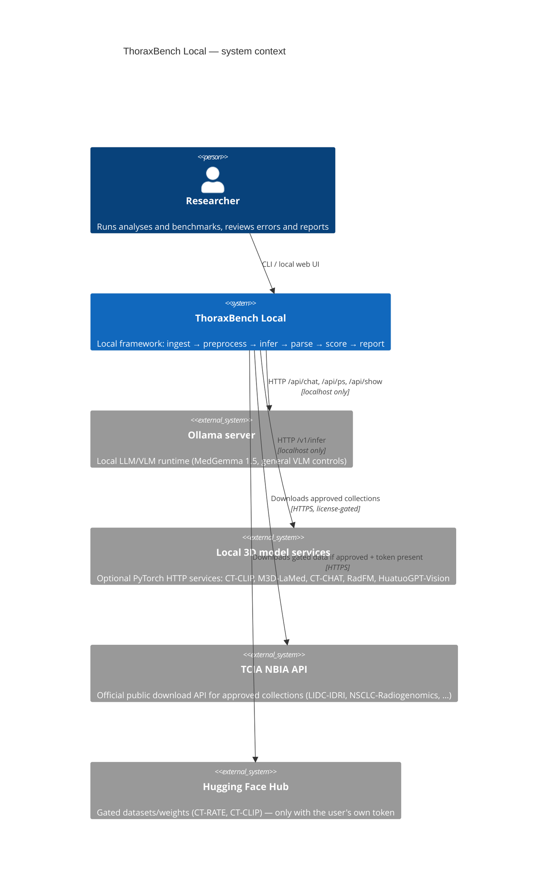
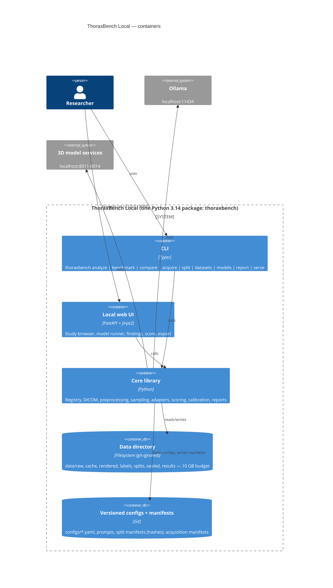
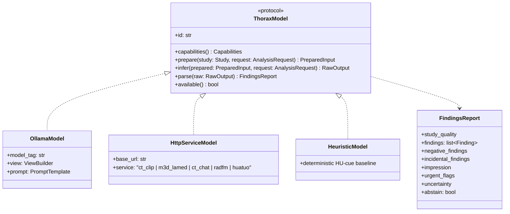
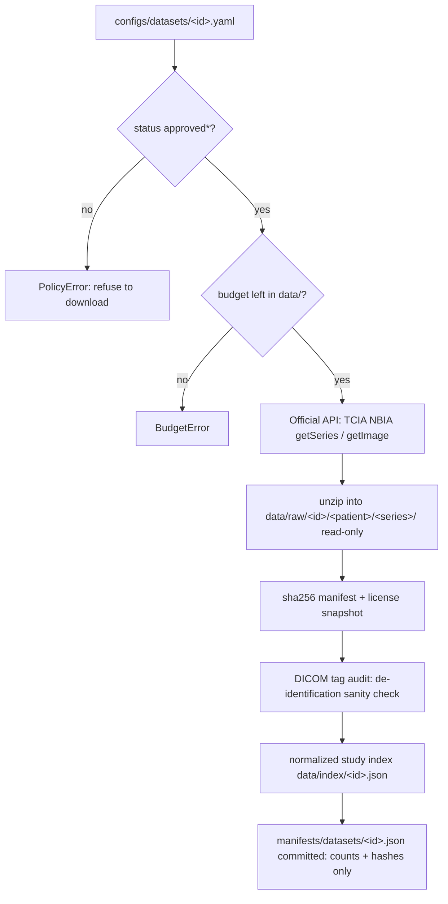
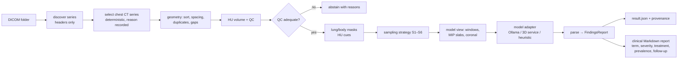
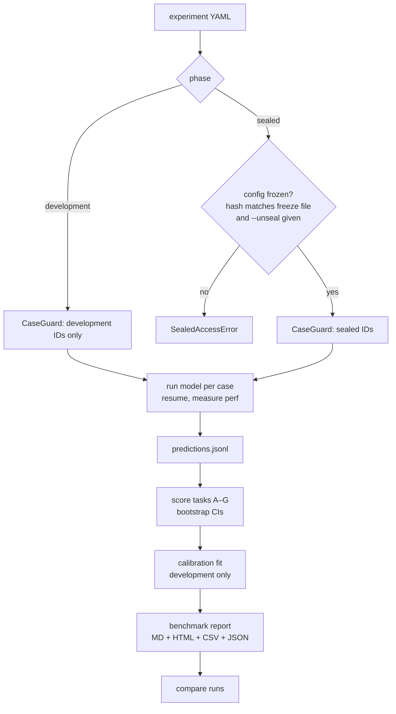
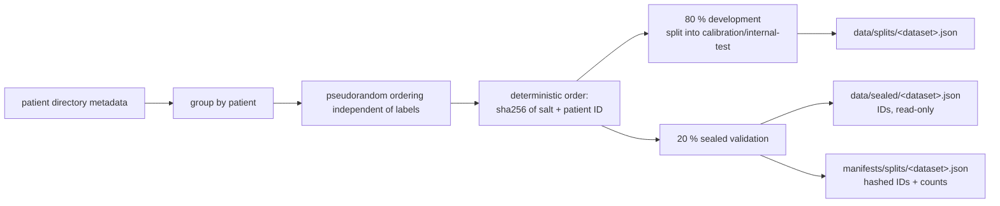
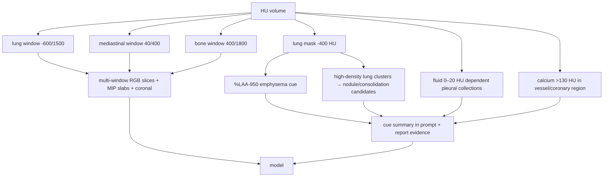
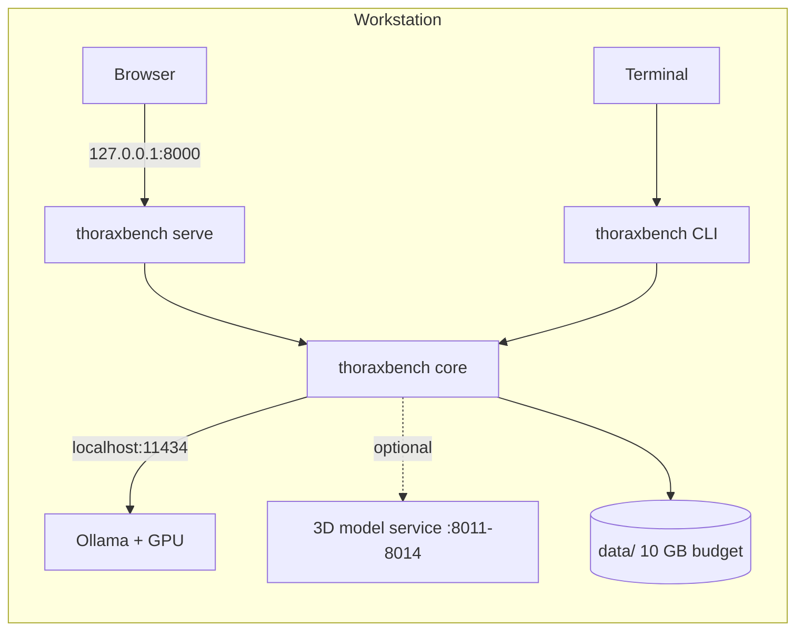

# ThoraxBench Local — Architecture

This document describes ThoraxBench Local with the [C4 model](https://c4model.com/)
(Context → Containers → Components → Code) plus flowcharts for the main workflows.
Diagrams are Mermaid, so GitHub renders them directly.

Source of requirements: [`Vision.md`](../Vision.md). Section references (§) point there.

> Research use only. This self-made experimental tool is not professional medical advice.
> Findings may be incorrect, incomplete or misleading. Do not use outputs for diagnosis or
> treatment decisions.

## Read the diagrams against current scope

The diagrams include target architecture. A drawn component does not establish that its
CLI command is implemented. Current commands are `analyze`, `demo-data`, `index`, `split`,
`datasets`, `models`, `serve`, `info` and `--version`. Use
`uv run thoraxbench --help` from the repository root to check the installed interface.
Acquisition, frozen benchmarking, reference-scored comparison and their reports remain open.

1. Read `docs/plan.md` for the active work package.
2. Locate the affected component below.
3. Check its implemented contract in `src/thoraxbench/`.
4. Preserve the split, endpoint and output-path guards.
5. Run `./localPipeline.sh --fast` while iterating.
6. Run the full gate through `scripts/commit.sh` before committing.

**Checkpoint:** CLI and API call the same core guards and analysis functions. If a proposed
path bypasses a guard, reject that design rather than weakening the guard.
**Recovery:** inspect `.pipeline/<stage>.log` after a failed gate and fix the cause.

The pilot uses metadata-only pseudorandom patient splits before development indexing.
The stratified split design below remains a future research option, not the pilot procedure.

---

## 1. System context (C4 level 1)

CT pixels, rendered images, predictions and labels stay on the workstation. Inference uses
only loopback services. Outbound setup/acquisition can obtain approved datasets, documentation,
source packages, model weights and metadata (§2.1, §29). It must not send study data.

---

## 2. Containers (C4 level 2)

---

## 3. Components (C4 level 3) — the `thoraxbench` package

```mermaid
C4Component
    title thoraxbench core library — components

    Container_Boundary(core, "thoraxbench") {
        Component(config, "config", "pydantic-settings style", "Paths, endpoints, budget; env THORAXBENCH_*")
        Component(registry, "registry", "YAML + pydantic", "Dataset/model registry, license status, policy gate")
        Component(ingest, "ingest", "httpx", "Source-specific acquisition (TCIA), checksums, manifests, budget, de-id audit")
        Component(dicom, "dicom", "pydicom + numpy", "Series discovery/selection, geometry, HU volume, QC")
        Component(preprocess, "preprocess", "numpy/scipy", "Windows, masks, MIP/coronal, deterministic HU cues")
        Component(sampling, "sampling", "numpy", "S1–S6 slice-selection strategies (versioned)")
        Component(views, "views", "Pillow/numpy", "Model-specific inputs: medgemma_ct_v1, generic_multislice_v1, ct_clip_v1, m3d_lamed_v1")
        Component(prompts, "prompts", "YAML templates", "P0–P4, versioned + hashed")
        Component(adapters, "adapters", "httpx", "ThoraxModel interface: Ollama, HTTP 3D service, HU-heuristic baseline")
        Component(parsing, "parsing", "pydantic", "Robust JSON extraction → FindingsReport")
        Component(ontology, "ontology", "YAML", "Canonical labels, dataset mappings, clinical knowledge base")
        Component(labels, "labels", "xml/csv", "Reference labels per dataset (e.g. LIDC XML)")
        Component(splits, "splits", "hashlib", "Patient-level stratified 80/20 split, sealing guard")
        Component(scoring, "scoring", "numpy/sklearn", "Tasks A–G metrics, bootstrap CIs, FROC")
        Component(calibration, "calibration", "sklearn", "Thresholds, temperature, isotonic, abstention")
        Component(perf, "perf + provenance", "psutil/nvidia-smi", "Latency/VRAM/RAM, hashes, git commit, hardware")
        Component(benchmark, "benchmark", "Python", "Experiment runner, resumable results, compare")
        Component(reports, "reports", "Jinja2/Markdown", "Benchmark report + per-study clinical Markdown report")
    }

    Rel(ingest, registry, "checks status before any download")
    Rel(dicom, preprocess, "HU volume")
    Rel(preprocess, sampling, "masks + cues")
    Rel(sampling, views, "slice indices")
    Rel(views, adapters, "prepared input")
    Rel(prompts, adapters, "prompt text")
    Rel(adapters, parsing, "raw output")
    Rel(parsing, scoring, "FindingsReport")
    Rel(labels, scoring, "ground truth")
    Rel(splits, benchmark, "allowed case IDs")
    Rel(benchmark, scoring, "predictions")
    Rel(scoring, reports, "metrics")
    Rel(ontology, reports, "clinical knowledge")
```

### Component responsibilities and contracts

| Module | Key types / functions | Notes |
|---|---|---|
| `study_access` | `guard_study_input(path, settings)` | Shared core input guard used by CLI and API; never import a private CLI helper into the API |
| `config` | `Settings` (`data_dir`, `ollama_url`, `data_budget_bytes`, `services`) | env prefix `THORAXBENCH_` |
| `registry` | `DatasetEntry`, `DatasetStatus`, `load_registry()`, `require_acquirable(entry)` → `PolicyError` | statuses from §6 plus `pending_access` |
| `ingest` | `TciaClient`, `acquire(dataset_id, plan)`, `write_manifest()`, `check_budget()`, `audit_deid()` | resumable, checksum-verified, raw immutable |
| `dicom` | `discover_series(root)`, `select_series()`, `load_volume(series)` → `Volume` | `Volume.hu: int16[z,y,x]`, `spacing_mm`, `qc` |
| `preprocess` | `apply_window()`, `lung_mask()`, `body_mask()`, `mip_slab()`, `coronal()`, `hu_cues(volume)` | canonical HU never altered (§9.3) |
| `sampling` | `SamplingStrategy` (`id`, `version`, `select(volume, cues) -> list[int]`), S1–S6 | deterministic; seed recorded if used |
| `views` | `ViewBuilder.build(volume, indices) -> PreparedInput` | `PreparedInput.images: list[bytes]`, `meta` |
| `prompts` | `PromptTemplate` (`id`, `version`, `sha256`, `render(labels, n_images)`) | P0–P4 |
| `adapters` | `ThoraxModel` protocol: `prepare`, `infer`, `parse`, `capabilities` (§17) | `OllamaModel`, `HttpServiceModel`, `HeuristicModel` |
| `parsing` | `extract_json(text)`, `parse_findings(raw, ontology)` → `FindingsReport` | never invents findings; invalid → abstain |
| `ontology` | `Label`, `ONTOLOGY`, `map_native(dataset, term)`, `ClinicalKB` | mapping back to native terms (§12) |
| `labels` | `load_reference(dataset, case)` → `ReferenceLabels` | LIDC XML parser: nodules, size, reader count |
| `splits` | `make_split()`, `SplitManifest`, `CaseGuard.allowed(phase)` → `SealedAccessError` | patient-level, label-stratified, deterministic hash |
| `scoring` | `task_a()`…`task_g()`, `bootstrap_ci()`, `froc()` | patient-level bootstrap |
| `calibration` | `fit_thresholds()`, `TemperatureScaler`, `IsotonicCalibrator`, `abstention_curve()` | fitted only on development data |
| `perf`, `provenance` | `measure()` context manager, `RunProvenance` | §21, §24 |
| `benchmark` | `ExperimentConfig`, `run_experiment()`, `compare_runs()` | results in `data/results/<run_id>/` |
| `reports` | `render_benchmark_report()`, `render_study_report()` | Markdown/HTML/CSV/JSON |

---

## 4. Code level (C4 level 4) — the adapter interface

---

## 5. Flowcharts

### 5.1 Acquisition (§8)

### 5.2 Single-study analysis (`thoraxbench analyze`, §18)

### 5.3 Benchmark with sealed validation (§14–§16)

### 5.4 Split creation and sealing

Current pilot procedure: inspect patient directory metadata before any development index.
Use a pseudorandom deterministic order independent of labels. Keep every patient's studies
together. Label stratification is a future alternative that requires its own frozen design.

### 5.5 Radiologist-style reading model

The preprocessing imitates how radiologists read chest CT (see `docs/reading_practice.md`):
a fixed search pattern by anatomy, several standard windows (lung, mediastinum, bone),
thin-slab MIPs for nodules, coronal reformats for craniocaudal extent, and deterministic HU
measurements. These measurements (emphysema %LAA-950, fluid-density pleural collections,
dense calcifications) are recorded as *evidence cues*. The model gets the cues as context but
they are never counted as a model finding on their own.

---

## 6. Deployment view

Everything runs on one workstation. There is no Docker image (dropped at the user's request);
the framework is a Python package installed with `uv`.

---

## 7. Cross-cutting decisions

| Concern | Decision |
|---|---|
| Reproducibility | Every run writes `run.json` with git commit, config/prompt/preprocess/split hashes, model digest, hardware, driver (§24). |
| Determinism | No random slice selection; Ollama `temperature=0`, `seed=0`. |
| Safety | Disclaimer in CLI output, UI banner and every report; abstention is a first-class result. |
| Privacy | No telemetry; logs redact paths/DICOM values; only de-identified research data. |
| Extensibility | New model = YAML in `configs/models/` + adapter class; new dataset = YAML + label loader. |
| Testing | Synthetic DICOM phantoms; Ollama mocked via `respx`; Playwright for the UI. |

## 8. Local GUI MVP and illustrated exports

The current workbench is a thin FastAPI interface over `analysis.analyze_study` and the
same development guards as the CLI. Both import `study_access.guard_study_input` from the
core. The API must not import private CLI helpers. Local vanilla JavaScript drives the slice slider,
model invocation and preference switches; all templates/styles/scripts are packaged
assets. There is no external frontend framework, CDN or telemetry. English/light are
first-visit defaults; English/German and light/dark preferences persist in browser storage.
The About endpoint derives runtime library versions and license declarations from installed
package metadata.

`AnalysisResult.prepared_images` retains actual prepared bytes only in memory and is
excluded from JSON serialization. Illustrated HTML exports embed those PNG bytes alongside
captions and finding references. HU-baseline previews are derived from source slice indices
and clearly marked as explanatory views. Missing or out-of-range evidence stays unresolved.
All model text is escaped; self-contained HTML needs no network asset requests. Derived
images and complete exports stay in ignored `data/results/`, never Git.

See [UI proposals and verification](ui.md) and the [actual synthetic test record](mvp-test.md).
The [40 GB VRAM/LAN design](lan-runner.md) is a proposal for tomorrow; the implemented
endpoint policy remains loopback-only.

Operator documentation ships at repository root as [`manual.html`](../manual.html) and
[`manual.pdf`](../manual.pdf), with configuration and operational checklists. These contain
no study images. Per-run HTML remains under ignored `data/results/`: it presents findings,
educational severity/attention and evidence galleries, while preserving uncertainty and
explicit self-made-tool/fallibility disclaimers. No severity is assigned to absent or
uncertain findings; educational context cannot establish whether care is needed.

### Exploratory multi-model comparison

The browser runs recommended available models sequentially through the shared analysis
endpoint to avoid concurrent model loading. It tracks request wall time separately from
recorded engine-stage duration, preserves partial results, and distinguishes errors,
abstentions and unavailable/skipped models. Recommendation is an explicit configured
inventory flag, not an accuracy rank. A comparison export combines existing guarded run
artifacts into one offline HTML review; it does not score reference labels or unseal cases.

### Explicit model acquisition and runtime forecasts

The model inventory carries adapter, license, terms/source links and setup guidance.
A terms-acknowledged operator action can request a pull for a configured Ollama tag.
`api.model_pulls.ModelPullJobs` tracks one active local pull and bounded session-only
snapshots. It reports actual current-layer bytes when supplied by Ollama; layer totals
can reset. The app must not invent whole-model progress. Weights remain in Ollama's store.
Optional HTTP services require publisher-approved manual setup and a healthy loopback
service. Availability never establishes accuracy or hardware capacity.

Browser forecasts start with broad workstation guesses. Later estimates use numeric
recent request durations keyed by model ID and image count in local storage. They do
not include study identifiers. Remaining-batch estimates sum available model estimates;
actual inference progress is unknown. Preserve this distinction from recorded engine time.
