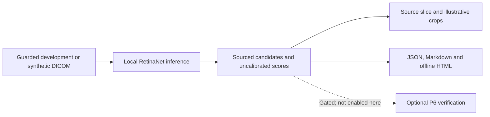

# Supervised detector reference baseline

> Research use only. This self-made experimental tool may return incorrect, incomplete
> or misleading findings. It is not professional medical advice or a basis for diagnosis
> or treatment decisions.

The optional `monai-lung-nodule` adapter runs the MONAI LUNA16 RetinaNet locally. It performs
inference only. It does not train, tune or download weights during analysis. Each candidate
carries `source: detector`, a centre in canonical `(z, y, x)` millimetres, an approximate box
size and the network's detection score. The study-level nodule score is the maximum
candidate score, or zero if the detector returns no candidates. It is not calibrated.

## Set up the optional baseline

Prerequisites: the source checkout, `uv`, Python 3.14, sufficient package/weight storage,
and the upstream terms linked below. Run every command from the repository root. The
normal installation and quality gate do not install the optional PyTorch stack.

1. Install the pinned optional dependencies.

   ```bash
   uv sync --frozen --all-groups --extra detector
   ```

2. Print the terms without downloading.

   ```bash
   uv run --extra detector python scripts/fetch_monai_bundle.py
   ```

   Expected result: the terms and target directory, followed by exit status 2.

3. After reviewing the terms, explicitly acquire the pinned bundle.

   ```bash
   uv run --extra detector python scripts/fetch_monai_bundle.py --accept-terms
   ```

4. Verify the local files.

   ```bash
   uv run --extra detector python scripts/fetch_monai_bundle.py --verify
   ```

**Checkpoint:** all five files pass size and SHA-256 checks. They stay under ignored
`data/models/monai/`. The state dict is approximately 84 MB. Python/CUDA packages need
substantially more disk space. No TorchScript or upstream Python is downloaded/executed.
**Recovery:** preserve errors. Check free space, the optional dependencies and the exact
pinned revision. Do not replace a checksum or disable verification to accept other weights.

## Run the synthetic workflow

1. Create the phantom.

   ```bash
   uv run --extra detector thoraxbench demo-data data/demo/mvp
   ```

2. Analyze it locally.

   ```bash
   uv run --extra detector thoraxbench analyze data/demo/mvp \
     --model monai-lung-nodule --output data/results/detector-demo.json \
     --report data/results/detector-demo.md
   ```

**Checkpoint:** the result identifies the detector and records candidates, weights digest,
prepared-input hash, adapted preprocessing hash and runtime information. A phantom result
checks execution; it does not establish detection accuracy. Missing weights or a backend
failure must remain explicit. A zero-candidate response is fallible, not evidence of health.

The default sliding-window ROI is `256 × 256 × 128`, with 0.25 overlap. Auto device selection
uses CUDA only when at least 3000 MiB is free; otherwise it uses CPU. CPU can be slow. Set
`THORAXBENCH_DETECTOR_DEVICE=cpu` or `cuda` to request a device explicitly. Run one GPU job
at a time. A server-side cancellation must report whether its provider has actually stopped.

## Run the calibration reference experiment

Prerequisites: approved acquisition, the frozen split, a development-only index, verified
weights and a free local inference device. Do not regenerate an existing split.

```bash
uv run --extra detector thoraxbench benchmark \
  configs/experiments/E013_luna16_bundle.yaml --limit 1
```

The YAML permits calibration cases only. `--limit 1` selects at most one per dataset. Use
the saved requests, raw output, provenance and checkpoint under `data/results/benchmark/`.
Keep failures and abstentions. Do not use internal-test or sealed cases to pick settings.

The report separates dataset rows and marks `possible_training_overlap`. **LUNA16 is drawn
from LIDC-IDRI. Every LIDC row is overlap-flagged and cannot establish unbiased accuracy.**
NSCLC-Radiogenomics is a distribution shift and has sparse lesion references; it does not
establish complete nodule sensitivity or false-positive rates. Aggregate FROC reflects only
the available annotations. No sealed result is produced.

Task C uses millimetre centres and the project hit radius `max(reference diameter / 2,
5 mm)`. `all_readers` targets every indexed reference nodule/mass. `luna16_style` targets
at least three readers and ignores candidates on fewer-reader lesions and duplicate hits.
Unindexed small nodules are not ignored. This is a documented project approximation,
**not the official LUNA16 evaluation script**. The score sweep is tested against a brute
force reference. Neither the metric name nor an overlap flag makes the cohort unbiased.

## Candidate crops for later verification

`thoraxbench.views.CandidateCropView.build(study, candidates)` creates in-memory lung-window
PNGs and one-based captions from millimetre centres. It supports axial/coronal planes and
optional MIP slabs. Captions omit detector scores so a later verifier is not told the
expected answer. Crop parameters and pixel hashes belong in verifier provenance.

The live GUI now lists each candidate's source, uncalibrated score, canonical centre and
approximate box size. Select **Show source slice** to navigate to the nearest axial slice
in the result's study. The action runs no inference and adds no verified overlay. The
source-slice control is disabled when the slice is unavailable.

The first 12 candidates receive axial and coronal 64 mm illustrative crops at 256 pixels;
all candidates remain in the table and JSON. The HTML export embeds those illustrations
and the Markdown export lists the candidates. These are post-inference review images,
not detector inputs, model-image evidence or completed VLM verification. The standalone
report remains usable offline. No stored benchmark case images are re-rendered.

The model appears in **Model availability & setup**. Installation and weight acquisition
remain manual commands, with explicit terms acknowledgement. The About inventory includes
installed optional MONAI/PyTorch packages and their declared licenses. Both interface
languages/themes and accessible tooltips apply to candidate review. The detector reads
the HU volume; the source-slice count control does not affect it.

Detector boxes with nonfinite coordinates/scores, invalid extents, out-of-volume positions
or scores outside [0, 1] fail explicitly and abstain. Do not silently drop candidates,
clamp scores, or interpret the failure as a negative study. Nonfinite crop centres are
refused. Optional VLM verification remains gated on the image-path sanity/protocol work;
this review flow starts no verifier inference.

## Upstream identity and deviations

The [MONAI bundle](https://huggingface.co/MONAI/lung_nodule_ct_detection/tree/9d6622fda0e52be0a4155fed2e0afb9c17bcd80b)
is version 0.6.10 at revision `9d6622fda0e52be0a4155fed2e0afb9c17bcd80b`.
Its [metadata](https://huggingface.co/MONAI/lung_nodule_ct_detection/blob/9d6622fda0e52be0a4155fed2e0afb9c17bcd80b/configs/metadata.json)
identifies MONAI as author and research/example use. The
[Apache-2.0 license](https://huggingface.co/MONAI/lung_nodule_ct_detection/blob/9d6622fda0e52be0a4155fed2e0afb9c17bcd80b/LICENSE)
and [training-data notices](https://huggingface.co/MONAI/lung_nodule_ct_detection/blob/9d6622fda0e52be0a4155fed2e0afb9c17bcd80b/docs/data_license.txt)
are stored alongside the weights. The latter name LUNA16 (CC BY 4.0) and LIDC-IDRI
(CC BY 3.0). Each fetched file has a pinned size and SHA-256 in `detectors/bundle.py`.

The network topology, anchors and selector settings follow the
[upstream inference configuration](https://huggingface.co/MONAI/lung_nodule_ct_detection/blob/9d6622fda0e52be0a4155fed2e0afb9c17bcd80b/configs/inference.json).
The adapter uses a smaller ROI and corner-aligned SciPy resampling toward the bundle's
spacing, rather than upstream MONAI `Spacingd`. It maps boxes back using the effective
grid spacing. This adapted view is hashed; it is not a numerical upstream reproduction.
It inherits the engine's standard axial canonical-volume assumptions. Oblique/nonstandard
in-plane geometry requires a separately validated affine-aware path before interpreting
localization results.

## Compatibility evidence (2026-10-17)

The existing local five-file bundle passed revision/size/checksum verification. A real
state-dict synthetic CPU API smoke ran with PyTorch 2.14.1, torchvision 0.29.1 and MONAI
1.6.1. It used a deliberately tiny `32 × 32 × 16` ROI and two torch threads, returned two
boxes, and recorded 0.260 seconds of network time and approximately 1.02 GB process RSS.
These are reduced synthetic API checks, not the default-ROI latency, a calibration result,
a GPU measurement or evidence of detection accuracy. No new weight download was needed.

## Review workflow



The review images help inspect which proposal belongs to which location. They do not
establish lesion presence. Stored benchmark case detail continues to show saved captions
and image counts without re-rendering unavailable prepared pixels.
