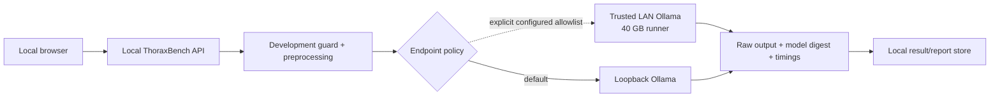

# Tomorrow's proposal: a 40 GB VRAM runner on the LAN

> Research use only. This is a design proposal, not implemented or remotely tested.
> Model size and available VRAM do not establish medical accuracy.

## What the extra VRAM enables

Assume one runner with roughly 40 GB usable GPU memory. The following are candidates,
not a performance ranking. Sizes below are approximate Ollama download sizes verified
on 2026-10-15; runtime also needs the vision encoder, KV cache and compute buffers.
Start with one loaded model, a bounded context and a small image count, then measure.

| Candidate | Approximate package | Why evaluate it | Fit expectation to verify |
|---|---:|---|---|
| `medgemma1.5:4b-it-bf16` | 8.6 GB | Same 1.5 model without Q4/Q8 weight quantization | Comfortable candidate; compare directly with current Q4/Q8 |
| `medgemma:27b-it-q4_K_M` | 17 GB | Larger medical model from the MedGemma 1 family | Plausible with substantial headroom at bounded context |
| `medgemma:27b-it-q8_0` | 30 GB | Quantization comparison for the 27B model | Plausible but tighter; measure image/context overhead |
| `gemma3:27b` | 17 GB | General Gemma-family vision control | Plausible; separates model scale from medical specialization |
| `qwen3-vl:32b-instruct-q4_K_M` | 21 GB | Larger independent general vision-language control | Plausible at bounded context; verify full GPU residency |
| `qwen3-vl:30b-a3b-instruct-q4_K_M` | 20 GB | Mixture-of-experts alternative for throughput/quality comparison | All expert weights still occupy memory despite fewer active parameters |

MedGemma 27B is **not MedGemma 1.5 27B**: Google's current 1.5 release is 4B only.
The 27B BF16 package is about 55 GB, exceeding 40 GB before runtime overhead. Do not
assume maximum advertised context or multiple simultaneous models fit. More VRAM also
makes some CT-native services worth assessing, but CT-CLIP/M3D/CT-CHAT remain separate
local HTTP adapters with their own dependency, weight-license and feasibility checks.

Primary sources: [Google MedGemma 1.5 model card](https://huggingface.co/google/medgemma-1.5-4b-it),
[MedGemma tags](https://ollama.com/library/medgemma/tags),
[MedGemma 1.5 tags](https://ollama.com/library/medgemma1.5/tags),
[Gemma 3 tags](https://ollama.com/library/gemma3/tags),
[Qwen3-VL tags](https://ollama.com/library/qwen3-vl/tags).

## Proposed connection architecture

Today `THORAXBENCH_OLLAMA_URL` exists, but `require_local_endpoint()` rejects non-loopback
hosts. Changing that URL alone to a LAN IP deliberately fails. Keep this default.



Add an opt-in `lan` endpoint mode with an explicit allowlist of literal private IPs,
for example `192.168.1.40:11434`. Retain loopback as the default. The existing adapter
contract, prompts, parsing, split checks and reports stay shared. Do not replace the
guard with unrestricted URL acceptance, a subnet-wide exemption or a cloud fallback.

Proposed configuration names (not supported yet):

```text
THORAXBENCH_INFERENCE_MODE=lan
THORAXBENCH_ALLOWED_OLLAMA_ENDPOINTS=http://192.168.1.40:11434
THORAXBENCH_OLLAMA_URL=http://192.168.1.40:11434
```

The runner administrator can bind Ollama to its private interface using `OLLAMA_HOST`,
as described in the [official FAQ](https://docs.ollama.com/faq). Restrict access to the
workstation through the runner firewall; use an authenticated TLS reverse proxy or a
tunnel when the LAN is not trusted. Do not expose the inference service to the internet.
No remote setup commands are being executed today.

The UI should display the configured runner and explain that rendered research images
and prompts are sent to that host. Keep raw DICOM files, reference labels, split IDs,
results and reports on the workstation. The workstation's development guard runs
**before** any transfer; holdout access remains frozen-benchmark-only.

## Implementation and verification checklist for tomorrow

1. Introduce one endpoint-policy object used by every inference adapter factory;
   allow only loopback or the exact configured LAN endpoint, reject credentials,
   redirects, proxy forwarding and unapproved hosts. Test IPv4/IPv6 and malformed URLs.
2. Verify server reachability, installed tags, actual digest, vision capability and
   Ollama version. Start with the existing 4B checkpoint to isolate networking from
   a model change. Do not silently pull or switch model weights.
3. Record endpoint identity and server version in provenance; keep client and server
   timing distinct. Local `nvidia-smi` describes the workstation, not the remote GPU.
   Report remote GPU/driver/VRAM as unknown unless explicitly collected from the runner.
4. Run a synthetic end-to-end smoke test, then calibration-only real studies; compare
   local/LAN results with the same digest, prompt, image hashes, context and decoding.
5. Measure actual VRAM, model residency, image count/context limits, latency, token rate,
   schema compliance, failure/abstention rate and useful findings for each larger model.
6. Choose configuration on calibration; evaluate on the internal development test set.
   Run the sealed holdout only after implementing the frozen benchmark and explicit
   unsealing. A LAN connection must never weaken that boundary.

No new weights, remote endpoint calls or runtime policy changes are included in today's
documentation/UI work.
