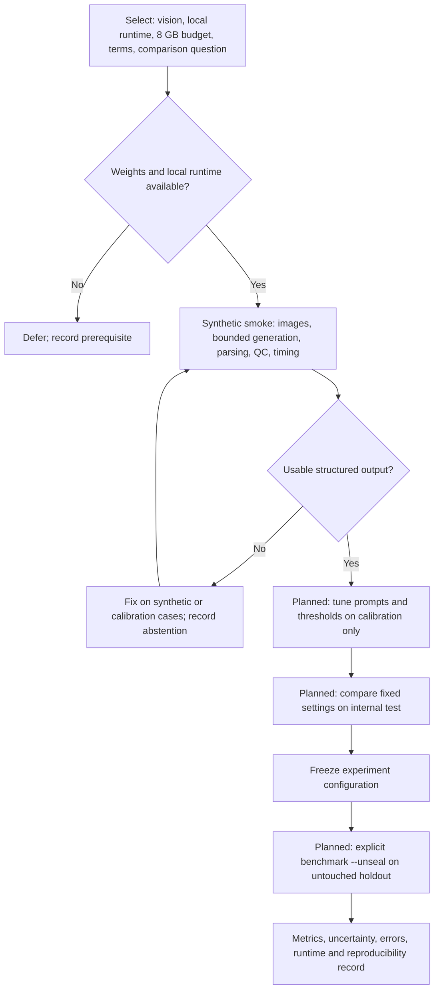

# Model selection and evaluation

> Research use only. This self-made experimental tool is not medical advice from a
> qualified healthcare professional, a diagnosis, or a medical device. Available models
> and reference knowledge may produce incorrect, incomplete or misleading findings.
> Do not use outputs for diagnosis or treatment decisions.

**Status: 2026-10-15. No model accuracy benchmark has been completed.** Models are selected
for vision input, local execution on the RTX A2000 with 8 GB VRAM, applicable license terms,
and a useful comparison question. This is a comparison design, not a performance ranking.

MedGemma is developed by **Google**, based on **Gemma 3**. This project uses the
`medgemma1.5` packages distributed through the Ollama library; Google supplies the upstream
model and Ollama supplies the package/runtime. [Google model card](https://huggingface.co/google/medgemma-1.5-4b-it),
[Ollama library](https://ollama.com/library/medgemma1.5).

## Which models, and why?

Installed status below was checked against the local Ollama `/api/tags` endpoint.
Configuration files live in [`configs/models/`](../configs/models/).

| Model / configuration ID | Why include it? | Installed or available locally? | Evidence so far |
|---|---|---|---|
| HU rules — `heuristic-hu` | Deterministic control: what can simple density measurements recover without learned weights? | Yes; built into the engine | Synthetic pipeline smoke: 0.465 s measured stages; one authorized real development study also completed. No accuracy benchmark. |
| MedGemma 1.5 Q4 — `medgemma1.5-q4` | Primary medical VLM candidate; practical local weight size (3.34 GB) | Yes; `medgemma1.5:4b-it-q4_K_M` | Live synthetic transport smoke completed in 49.5 s, but returned empty findings. No useful detection or accuracy demonstrated. |
| MedGemma 1.5 Q8 — `medgemma1.5-q8` | Same model at higher precision: test accuracy/runtime/memory tradeoffs against Q4 | Yes; `medgemma1.5:4b-it-q8_0` (4.98 GB weights) | Earlier synthetic image-count smoke recorded in the research notes; full current analysis path and accuracy comparison pending. |
| Gemma 3 4B — `gemma3-4b` | General model from the same architecture family: investigate the effect of medical specialization | **No**; configured `gemma3:4b-it-q4_K_M` tag is absent | Availability prerequisite pending; no project accuracy benchmark. |
| Qwen3-VL 4B — `qwen3-vl-4b` | Independent general VLM family, for comparison beyond Gemma | Yes; `qwen3-vl:4b` (3.30 GB weights) | Installed; live analysis smoke and accuracy evaluation pending. |
| CT-CLIP, M3D-LaMed, CT-CHAT, RadFM | Later volumetric comparators: investigate information lost by presenting CT as selected 2D images | Deferred optional local services | Weight access, memory and runtime integration remain prerequisites; no project benchmark. |

Weight size is disk usage, not total VRAM demand: images and context also consume memory.
Other locally installed models are not automatically part of the first comparison.
MedGemma uses HAI-DEF terms, Gemma uses Gemma terms, and the Qwen configuration records
Apache-2.0. Model and dataset terms must each be considered independently.
[Google's MedGemma model card](https://huggingface.co/google/medgemma-1.5-4b-it) documents its
medical specialization and Gemma lineage; package variants are listed by Ollama for
[MedGemma](https://ollama.com/library/medgemma1.5/tags),
[Gemma 3](https://ollama.com/library/gemma3/tags), and
[Qwen3-VL](https://ollama.com/library/qwen3-vl/tags).

The Gemma comparison helps investigate medical specialization but cannot isolate training
as the only cause of a difference: checkpoints, prompts and view choices also matter.
Q4 and Q8 should use the same cases, prompt, images and settings when testing quantization.
Across model families, record model-specific views. Match image budgets where possible.

For the current browser comparison, enable **Compare recommended local models**, then select
**Compare local models**. Inspect failures, abstentions and skipped models beside completed
runs. Save **Download comparison HTML** for an offline evidence review. This flow compares
outputs; it computes no reference-label accuracy or consensus diagnosis.

## Check a candidate before a run

Start in the repository root with the locked environment installed.

1. Read the model's terms and configuration in `configs/models/`.
   For missing weights, use **Model availability & setup** in the UI. Ollama downloads
   require a separate explicit action after terms acknowledgement. Optional HTTP services
   require publisher access, compatible weights/hardware and a configured loopback service.
2. Run `uv run thoraxbench models`.
3. Confirm that the intended configuration is available locally.
4. Follow the synthetic run in [the manual](../manual.html#commands).
5. Inspect the output status, QC and structured findings.
6. Save the JSON, Markdown and HTML.

**Checkpoint:** available means locally runnable. It does not mean accurate. A usable
synthetic response is a prerequisite to development evaluation, not an accuracy result.

**Recovery:** if weights or a service are unavailable, record that prerequisite and defer
the model. Preserve failures and abstentions. Fix prompts only on synthetic or calibration
cases. Do not tune on internal-test or sealed cases.

## From a candidate to a measured result

The patient holdout is already frozen: LIDC has 48 development / 12 holdout patients;
NSCLC-Radiogenomics has 22 / 5. Holdout studies are excluded from development indexing,
prompt work and tests. The planned final evaluation requires a frozen experiment and
explicit unsealing; it is not part of an ordinary smoke test.

## What do we get?

**Available in the MVP:** findings JSON, raw model output, an English research Markdown
report, offline illustrated HTML review with educational severity/follow-up context, QC
limitations, abstention status, measured stage times and provenance hashes.
The report provides educational terminology and guideline context, not a patient care plan.

**Planned from benchmarking:** reference-label comparisons with per-label sensitivity,
specificity, precision, F1 and AUROC where defined; calibration measures and confidence
intervals; failures/abstentions; and runtime/memory comparisons. Missing reference labels
remain unknown rather than being treated as negative. These measurements will show which
labels and representations work under a recorded experiment, with their limitations.

Current timings are smoke observations, not comparable speed rankings. The Q4 test used a
synthetic single-label request with a sampled slice plus a MIP view at 256 px. Its empty
findings now trigger abstention. A full-label request generated more than 4,000 tokens and
was stopped; the engine now caps generation at 4,096 tokens and treats truncation as
abstention. Improving usable structured output comes before claiming detection quality.

See the current [`plan`](plan.md) for implementation status. The longer
[`model research notes`](model_cards.md) retain historical image-count experiments; local
installation status in this page supersedes contradictory historical installation notes.

For tomorrow's larger hardware and networking work, see the [40 GB VRAM and LAN runner
proposal](lan-runner.md). It has candidate sizes, the endpoint-policy design and verification
steps; no remote inference is enabled today.
