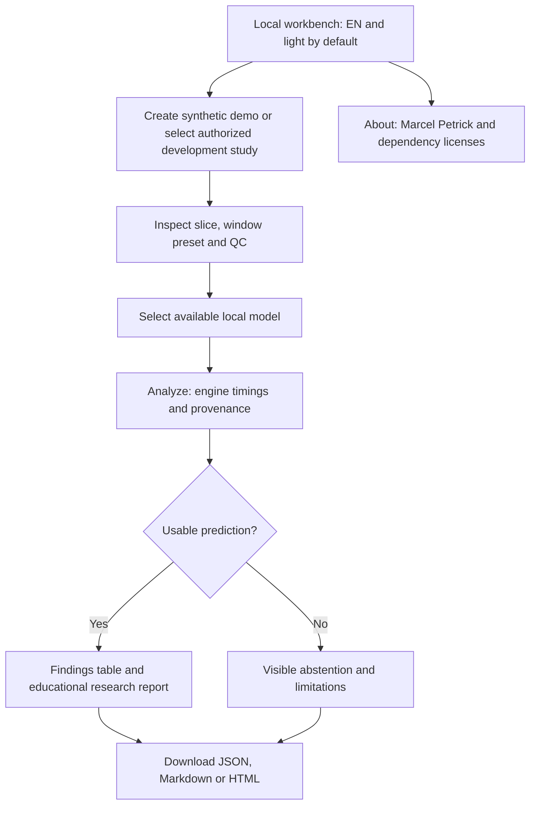
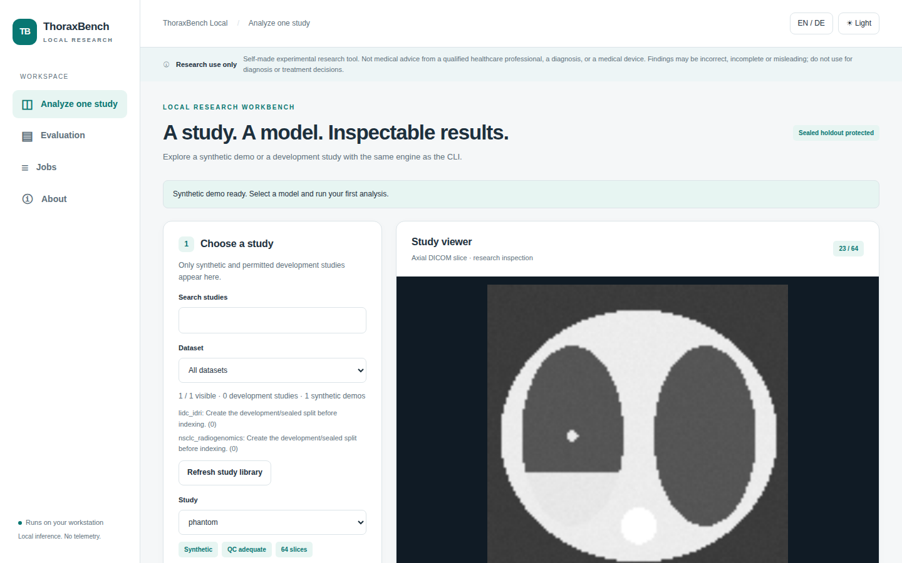
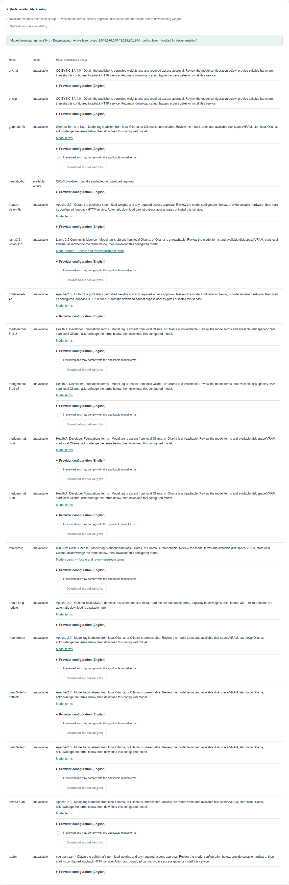
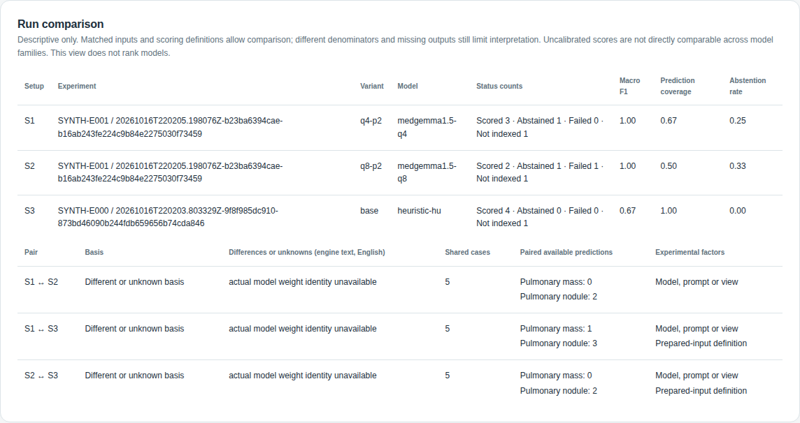
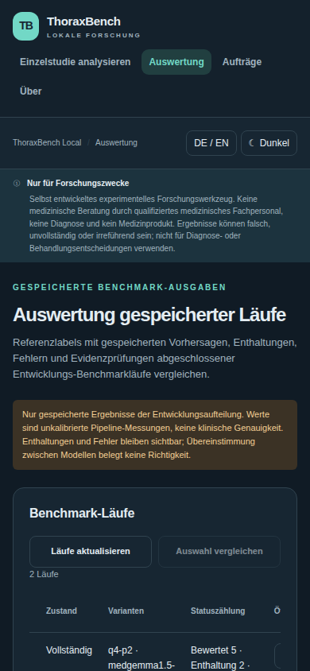

# ThoraxBench Local — UI design and acceptance

> Research use only. This self-made experimental tool is not medical advice from a
> qualified healthcare professional, a diagnosis, or a medical device. Available models
> and reference knowledge may produce incorrect, incomplete or misleading findings.
> Do not use outputs for diagnosis or treatment decisions.

The user brought the GUI MVP forward on 2026-10-15: a testable local graphical workflow now
ships alongside the engine. Exploratory model-output comparison is implemented.
Development reference scoring exists in the CLI. Reference-scored GUI views and advanced
review remain deferred. UI feature work is frozen after v0.2.0; only fixes/docs are in scope.
The CLI and GUI call the same core functions and enforce the same development split guards.

## Two concrete proposals

| Proposal | Layout and interaction | Strength | Tradeoff | Decision |
|---|---|---|---|---|
| **Guided workbench** | Numbered steps: create/select a synthetic or development study → inspect slices and QC → choose a local model → analyze → review findings and download. A compact top bar holds language, theme and About. | Makes the first successful research run discoverable; useful on a laptop and stacks naturally on mobile. | Fewer simultaneous comparisons. | **Implement for the MVP.** |
| Dense reviewer | Persistent study list at left, large central slice viewer, model/findings panel at right; comparison tabs, run history and keyboard shortcuts. | Faster repeated review of many studies and side-by-side experiments. | More controls compete for attention; poor fit for narrow screens and unfinished benchmark data. | Revisit after measured runs exist. |

No dedicated frontend-design skill is installed in this session. Design choices follow the
research workflow and accessibility requirements: visible state, short labels, deliberate
progression, semantic controls, and helpful explanations without requiring technical setup
knowledge. Keep research caveats visible near findings rather than relying on an About page.

## Operator procedure

Prerequisite: a running local server. Use `uv run thoraxbench serve` from the repository root.

1. Open `http://127.0.0.1:8000` on the same computer.
2. Select **Create synthetic demo** or an indexed development study.
3. Inspect the viewer and QC status.
4. Select an available model.
5. Select **Run analysis locally**.
6. Inspect status, findings and educational context.
7. Save the HTML, JSON or Markdown download.

**Checkpoint:** results retain their model identity, evidence and provenance. A downloaded
HTML report opens without the server. Display-window changes do not change analysis.

**Recovery:** preserve errors and abstentions. Check model availability and permitted study
membership. Never bypass a split rejection. See [the manual](manual.html#recovery).

## Guided workbench



The image viewer and model controls sit alongside each other on wide screens and stack on
small screens. The findings table uses a contained scrolling region if needed; the page
itself must not overflow horizontally. A synthetic demo is the easiest first action and
never needs real patient data, model downloads, or an Ollama connection when using HU rules.

## Live runtime and recommended-model comparison

The request timer advances while inference is pending. It measures browser waiting time,
including network and server work, and does not establish actual model progress. The engine
stage duration remains a separate recorded result. A batch shows the active model, batch
position and elapsed waiting time; failures stop that model's timer and allow later models
to proceed.

The **Rough remaining estimate** starts with broad workstation guesses: 1–60 seconds for
the HU baseline and 1–15+ minutes for a vision model. Later estimates use recent local
request durations for the same model and image count. They are not measured benchmarks,
inference progress or deadlines. Hardware, input size and cold loading can exceed them.
Only numeric duration history is stored locally; no study identifiers are used.

A comparison adds estimates for the remaining available models. The UI subtracts active
elapsed time. If the estimate is exceeded, it says **Taking longer than estimated; still
running**. It does not display a negative countdown or an inference percentage.

To compare outputs:

1. Enable **Compare recommended local models**.
2. Select **Compare local models**.
3. Inspect each model's status in the comparison table.
4. Compare finding presence and uncalibrated scores in the finding matrix.
5. Inspect each model's individual report and downloads.
6. Select **Download comparison HTML**.

**Checkpoint:** each available candidate runs sequentially. Partial results remain visible.
**Batch progress** shows model position; it does not show an inference-completion percentage.

The recommended inventory contains:
`heuristic-hu`, `medgemma1.5-q4`, `medgemma1.5-q8`, `gemma3-4b`, `qwen3-vl-4b`.
Only locally available candidates are attempted. Availability failures, abstentions and
skipped models are explicit; partial successes remain inspectable. A finding matrix shows
per-model outputs and each run retains its own report and downloads. Scores across models
are uncalibrated and are not directly comparable; agreement does not validate a finding.
This is an exploratory output comparison without reference-label accuracy scoring.

A combined offline HTML review preserves per-run evidence and educational context. It uses
existing guarded results rather than triggering additional inference. Restart an already
running server after upgrading so its API and browser assets use the same version.

## Check the actual input count

The image-count setting is a sampling target. Anatomy sampling preserves landmarks and
can exceed that target; added coronal views can also increase the prepared count. Inspect
the actual prepared previews and count in the result. Wait estimates use requested image
counts and remain guesses. A strict small-image diagnostic uses uniform sampling without
additional views. Do not describe a recording as four-image inference until verified.

## Unavailable model setup

For the usual CLI setup, run `ollama run medgemma1.5:4b-it-q4_K_M` from the repository
root. Ollama downloads the missing model and opens chat. Enter `/bye`, then check
`ollama list` and select **Refresh model availability**. This tag maps to app ID
`medgemma1.5-q4`. Use the exact tag in the selected model YAML. For download only,
use `ollama pull medgemma1.5:4b-it-q4_K_M`. Start the installed Ollama service or
`ollama serve` separately if needed. Review the publisher's terms first.
See [the CLI setup and recovery](research-workflows.md#set-up-an-unavailable-model).

The browser offers an optional alternative:

1. Select the unavailable model in **Model**, then select **Set up local models**. The
   setup table opens at that model's row. Run stays disabled until the model is available.
   Opening setup starts no download.
2. Inspect the model's terms, adapter and provider information.
3. For Ollama, open **Model terms** before acknowledging permitted use.
4. Select **Download model weights** only after the terms acknowledgement.
5. Wait for the final download state.
6. Check the refreshed model inventory.

**Checkpoint:** the backend accepts only configured Ollama tags and one active pull.
The local Ollama service obtains weights using its own network and storage. **Active layer
bytes** is actual layer transfer data, not a whole-model percentage or inference progress.
Analysis and setup controls lock during the pending download.

**Recovery:** preserve **Download failed** details. Resolve terms/access, network, disk or
Ollama problems before retrying explicitly. The application provides no cancel endpoint.
No automatic background installation starts when the page opens.

For non-Ollama models, follow the provider links and **Provider configuration (English)**.
Obtain required access approval and weights. Check hardware/dependencies. Start a compatible
service at its configured loopback URL. Select **Refresh model availability** to recheck it.
A successful health response establishes service availability, not model accuracy.

## Review stored benchmark runs (Evaluation)

**Evaluation** is a read-only section beside **Analyze one study** and **About**. It reads
completed invocations below `data/results/benchmark/<experiment>/<run>/`. It never starts
inference, writes files, re-renders images or reads raw studies.

Prerequisite: a benchmark run finished from the CLI (see the README section *Run a
development benchmark*).

1. Select **Evaluation** in the sidebar. The runs table lists every invocation folder with
   experiment, run folder, configuration hash, start time, state, variants and status counts.
2. Select **Open** on a complete run. The run details show each variant's stored metrics and
   one row per case and variant: dataset, case, phase, variant, status, reference labels,
   prediction, abstention/parse warnings and the evidence check.
3. Narrow the rows with **Status filter**, **Evidence filter** or **Variant filter**.
4. Select **Details** on a row. The case detail shows reference versus prediction per label,
   the images sent to the model, the evidence check per finding, the parsed response (JSON),
   the raw model response as plain text and the text context sent.
5. To compare, select two or more setups with the checkboxes, then **Compare selected**. The
   table uses the existing descriptive comparison: basis, differences, shared cases, paired
   available predictions and experimental factors. It never ranks models.

**Checkpoint:** complete runs open; the state column explains every other folder.
**Recovery:** *Incomplete* runs open after the CLI run finishes (or after `--resume`).
*Unavailable* folders are legacy, corrupt or non-checkpointed outputs; rerun the benchmark.
*Refused* runs have a stored selection that fails the current development split guard; do
not edit split files to open them. Select **Refresh runs** after a new CLI run.

Boundaries:

- Only complete, integrity-checked development runs open. Each open re-checks the current
  split guard before any case artifact is read. Rows from a non-development phase are
  skipped and counted; sealed cases never appear.
- Benchmark artifacts store no prepared image pixels. The case detail states this and shows
  the recorded image count and captions; it never re-renders or substitutes images.
- Evidence verdicts classify the stored bounds check. In-range references are not proof of
  visual correctness. HU-baseline references are zero-based source slices.
- Identifiers are validated path components; symlinked experiment or run folders are
  ignored. All stored model text is shown as plain text.
- Navigating to Evaluation keeps the single-study analysis session, including a running
  request, its result and downloads.

## Language, appearance and help

- **English and light are explicit first-visit defaults**, even when the browser requests
  German or dark mode. Language and light/dark switches update immediately and persist
  locally across reloads. Users can deliberately select German and dark mode.
- Translate navigation, actions, labels, status messages and help text. Model identifiers,
  provenance identifiers and exported English research reports remain reproducible.
- Every interactive action and setting label has a concise explanation available on hover
  **and keyboard focus**. Tooltips use accessible descriptions, are readable in both themes,
  do not trap focus and do not replace visible labels. Native keyboard interaction remains
  available for selects, buttons and the slice slider.
- Every page shows the research disclaimer. Findings and educational severity/guideline
  context never claim diagnosis, clinical validity or treatment suitability.
- About names **Marcel Petrick**, links the project license, and displays dependency names
  with their license information. Installed package metadata is the source for dependency
  license labels; missing metadata is shown as unknown rather than guessed.

## Technical boundaries

| Concern | Requirement |
|---|---|
| Server | FastAPI app factory under `thoraxbench.api`; CLI `thoraxbench serve`, loopback default |
| Browser assets | Local templates, styles and scripts; no CDN, analytics, telemetry or cloud inference |
| Images | Core DICOM/HU/window rendering; only authorized development studies or generated synthetic demos |
| Study selection | Guard before any DICOM header, label, cache or pixel read; sealed/unknown cases denied |
| Inference | Same analysis function as CLI; local adapters; clear loading, failure and abstention states |
| Exports | Findings/provenance JSON, English research Markdown and standalone HTML with embedded actual images and finding/evidence links; no user-authored HTML execution |
| Privacy | Research IDs only; do not expose patient names/dates or unnecessary absolute paths |
| Evaluation | Read-only `GET /api/evaluation/*` over complete benchmark runs; split guard re-checked per open; no inference, writes or image re-rendering |
| Screenshots | Only the code-generated synthetic phantom, captured by `scripts/capture_screenshots.py` into `docs/assets/`; never commit patient images or real-study renders |

## Current screens

Synthetic phantom only; comparison and download states are mocked by
`scripts/capture_screenshots.py`. Evaluation captures read synthetic benchmark runs with
scripted (labelled) vision outputs. Timings and browser waits are fixed illustrative values,
not measurements.

| Screen | Screenshot |
|---|---|
| Study viewer |  |
| Results |  |
| Model comparison |  |
| Model setup |  |
| About |  |
| German, dark |  |
| Mobile |  |
| Evaluation runs and cases |  |
| Evaluation case detail |  |
| Evaluation comparison |  |
| Evaluation, German, dark, mobile |  |

## MVP acceptance and verification

Playwright runs an actual local server against a temporary synthetic-only data directory.
Run the browser checks from the repository root:

```bash
uv run playwright install chromium
uv run pytest tests/e2e -m "not live"
```

Install Chromium only if the browser is missing. The test suite starts its own temporary
server. Do not point it at patient data.

**Checkpoint:** all selected tests pass. **Recovery:** inspect the first failure and the
browser installation. Keep tests synthetic; do not substitute live or sealed cases.

The suite verifies the complete user workflow:

- EN/light first visit despite a DE/dark browser; switching and persistence after reload.
- Synthetic demo creation, case selection, visible rendered slice and slice navigation.
- Heuristic analysis produces a positive finding and downloadable JSON/Markdown/HTML outputs; HTML images render offline and evidence references are not claims of verified lesion localization.
- About shows Marcel Petrick, the project license and dependency license information.
- Helpful descriptions can be reached with hover and keyboard focus.
- Narrow mobile viewport remains usable with no horizontal page overflow.

The HTML review shows positive findings first, educational severity and typical attention,
follow-up context with stated assumptions, and linked source/input previews. Missing
confidence remains uncertain. No absent or low-rated finding establishes that review is
unnecessary. The UI and exports identify the self-made experimental tool and warn that
outputs may be incorrect, incomplete or misleading and are not professional medical advice.

Route integration tests cover validation, exports, unavailable models and denied study access.
The complete local pipeline runs both suites. A real browser capture from the synthetic
workbench may be kept at `data/results/ui-preview.png` for local inspection; the About screen
can provide a public README screenshot without medical imagery.

Operator instructions ship as [manual.html](manual.html) and a
[printable PDF](manual.pdf) generated from it. They cover installation, local configuration, first-run
checkpoints, report interpretation and recovery in short, direct instructions. Regenerate
the PDF after editing the HTML using the command at the end of the manual.

Deferred GUI scope: reference-scored comparison, persistent run history, reference overlays,
volumetric navigation and reader-study mode. Reference scoring of development cases exists
in the CLI only (`thoraxbench benchmark`). Sealed-holdout evaluation is not implemented;
`benchmark --unseal` is refused, and the GUI provides no unseal shortcut.

## Server-side jobs

Analysis, model comparison and acknowledged Ollama downloads share one FIFO worker.
Open **Jobs** to inspect waiting/running work, per-model steps and completed results.
The status bar and tab title follow the server job on every page. Reloading a page does
not start another inference. Duplicate active analysis submissions follow the existing job.
Cancel queued work before it reaches a model. Stop running work at the next stage boundary;
the connection closes, but the local provider may continue in the background. Completed
comparison steps remain available when later work fails or is stopped.

Elapsed times use the server monotonic clock. They freeze at completion and differ from
recorded engine stages and rough wait estimates. Browser storage keeps preferences and
numeric duration history only. Jobs/results links live in server memory (8 waiting,
32 terminal jobs retained), so a server restart loses the queue and registered links.
Saved report files remain under ignored `data/results/ui/`.

**Checkpoint:** submit a synthetic analysis, open About, reload, then open Jobs. The same
job remains visible. Cancel or inspect its completed report. If the server restarted,
open the saved report from disk or submit a new job.
