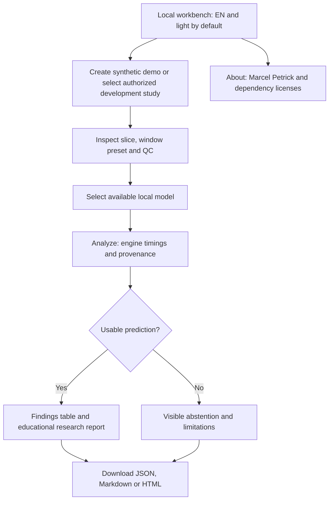

# ThoraxBench Local — UI design and acceptance

> Experimental research only — not medical advice, a diagnosis, or a medical device.

The user brought the GUI MVP forward on 2026-10-15: a testable local graphical workflow now
ships alongside the engine. Advanced benchmarking and comparison screens follow later.
The CLI and GUI call the same core functions and enforce the same development split guards.

## Two concrete proposals

| Proposal | Layout and interaction | Strength | Tradeoff | Decision |
|---|---|---|---|---|
| **Guided workbench** | Numbered steps: create/select a synthetic or development study → inspect slices and QC → choose a local model → analyze → review findings and download. A compact top bar holds language, theme and About. | Makes the first successful research run discoverable; useful on a laptop and stacks naturally on mobile. | Fewer simultaneous comparisons. | **Implement for the MVP.** |
| Dense reviewer | Persistent study list at left, large central slice viewer, model/findings panel at right; comparison tabs, run history and keyboard shortcuts. | Faster repeated review of many studies and side-by-side experiments. | More controls compete for attention; poor fit for narrow screens and unfinished benchmark data. | Revisit after measured runs exist. |

No dedicated frontend-design skill is installed in this session. Design choices follow the
research workflow and accessibility requirements: visible state, short labels, deliberate
progression, semantic controls, and helpful explanations without requiring technical setup
knowledge. Keep research caveats visible near findings rather than relying on an About page.

## Guided workbench

The image viewer and model controls sit alongside each other on wide screens and stack on
small screens. The findings table uses a contained scrolling region if needed; the page
itself must not overflow horizontally. A synthetic demo is the easiest first action and
never needs real patient data, model downloads, or an Ollama connection when using HU rules.

## Language, appearance and help

- **English and light are explicit first-visit defaults**, even when the browser requests
  German or dark mode. Language and light/dark switches update immediately and persist
  locally across reloads. Users can deliberately select German and dark mode.
- Translate navigation, actions, labels, status messages and help text. Model identifiers,
  provenance identifiers and exported English research reports remain reproducible.
- Every interactive action and setting label has a concise explanation available on hover
  **and keyboard focus**. Tooltips use accessible descriptions, are readable in both themes,
  do not trap focus and do not replace visible labels. Native keyboard interaction remains
  available for selects, buttons and the slice slider.
- Every page shows the research disclaimer. Findings and educational severity/guideline
  context never claim diagnosis, clinical validity or treatment suitability.
- About names **Marcel Petrick**, links the project license, and displays dependency names
  with their license information. Installed package metadata is the source for dependency
  license labels; missing metadata is shown as unknown rather than guessed.

## Technical boundaries

| Concern | Requirement |
|---|---|
| Server | FastAPI app factory under `thoraxbench.api`; CLI `thoraxbench serve`, loopback default |
| Browser assets | Local templates, styles and scripts; no CDN, analytics, telemetry or cloud inference |
| Images | Core DICOM/HU/window rendering; only authorized development studies or generated synthetic demos |
| Study selection | Guard before any DICOM header, label, cache or pixel read; sealed/unknown cases denied |
| Inference | Same analysis function as CLI; local adapters; clear loading, failure and abstention states |
| Exports | Findings/provenance JSON, English research Markdown and standalone HTML with embedded actual images and finding/evidence links; no user-authored HTML execution |
| Privacy | Research IDs only; do not expose patient names/dates or unnecessary absolute paths |
| Screenshots | Synthetic imagery stays in ignored `data/results/`; never commit patient images |

## MVP acceptance and verification

Playwright runs an actual local server against a temporary synthetic-only data directory.
It verifies the complete user workflow rather than implementation details:

- EN/light first visit despite a DE/dark browser; switching and persistence after reload.
- Synthetic demo creation, case selection, visible rendered slice and slice navigation.
- Heuristic analysis produces a positive finding and downloadable JSON/Markdown/HTML outputs; HTML images render offline and evidence references are not claims of verified lesion localization.
- About shows Marcel Petrick, the project license and dependency license information.
- Helpful descriptions can be reached with hover and keyboard focus.
- Narrow mobile viewport remains usable with no horizontal page overflow.

The HTML review shows positive findings first, educational severity and typical attention,
follow-up context with stated assumptions, and linked source/input previews. Missing
confidence remains uncertain. No absent or low-rated finding establishes that review is
unnecessary. The UI and exports identify the self-made experimental tool and warn that
outputs may be incorrect, incomplete or misleading and are not professional medical advice.

Route integration tests cover validation, exports, unavailable models and denied study access.
The complete local pipeline runs both suites. A real browser capture from the synthetic
workbench may be kept at `data/results/ui-preview.png` for local inspection; the About screen
can provide a public README screenshot without medical imagery.

Operator instructions ship as [manual.html](../manual.html) and a matching
[seven-page PDF](../manual.pdf). They cover installation, local configuration, first-run
checkpoints, report interpretation and recovery in short, direct instructions. Regenerate
the PDF after editing the HTML using the command at the end of the manual.

Deferred scope: benchmark run history/comparison, reference overlays, volumetric navigation,
and reader-study mode. The planned final holdout evaluation remains a separate frozen
benchmark operation; the GUI does not provide an unseal shortcut.
