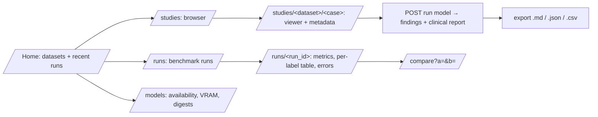

# ThoraxBench Local — UI concept

Status: concept agreed, implementation in WP9 (see [`plan.md`](plan.md)).
Requirements: Vision §18 (target web UI), §28 (safety), §29 (privacy).

## 1. Ideation — CLI only, or CLI + UI?

| Option | Pros | Cons | Verdict |
|---|---|---|---|
| CLI only | Scriptable, reproducible, trivially testable | Cannot *look* at a CT, slices or overlays; hard to review errors case by case (§32.8) | insufficient |
| Desktop app (Qt) | Native feel | Second toolkit, packaging work, harder e2e tests | rejected |
| SPA (React/Vite) | Rich interactivity | JS build chain, CDN temptations, duplicated logic | rejected (overkill) |
| **Local web UI: FastAPI + Jinja2 + HTMX, server-rendered PNG slices** | One language (Python), all HU logic stays testable in the core, no build step, works offline, Playwright e2e | Less fancy than a SPA | **chosen** |

**Decision:** the CLI is the engine for everything reproducible (acquire, split, benchmark,
compare, report). The web UI is a thin, local-only *review and exploration* layer over the same
core library. It never has features that bypass the CLI's guards (license gate, sealed split).

Ideas collected (✓ = in v1 scope, ○ = later):

- ✓ study browser with QC badges and split phase (sealed studies are hidden, never listed)
- ✓ slice viewer: scroll with slider/keys, window presets (lung, mediastinum, bone, abdomen),
  MIP slab toggle, coronal overview
- ✓ highlight the slices the model actually received and the evidence slices it cited
- ✓ run a model on the study (Ollama models, heuristic baseline; 3D services if available)
- ✓ findings table with confidence, severity, urgency, guideline advice; reference labels and
  a per-study score when ground truth exists
- ✓ the English Markdown clinical report rendered in the page, downloadable as `.md`
- ✓ export JSON / CSV / HTML / Markdown
- ✓ benchmark runs page: list runs, metrics tables, compare two runs
- ✓ reference annotation overlay (LIDC nodule centres/diameters) on the slice viewer
- ○ 3D volume rendering, ○ side-by-side model comparison per study, ○ reader-study mode

## 2. Principles

1. **Local only.** Binds to `127.0.0.1` by default; no external assets (HTMX is vendored);
   no telemetry.
2. **Research-only banner** on every page: "Experimental research output — not medical
   advice, not a medical device." (§18, §28)
3. **No new logic in the UI.** Routes call core functions; everything is unit-tested there.
4. **Privacy.** Shows research IDs only; never shows DICOM patient names/dates; paths are
   shortened relative to the data directory.
5. **Sealed split respected.** Sealed studies are not listed and their URLs return 403.
6. **Accessible and theme-aware:** semantic HTML, keyboard navigation for the slice viewer,
   light/dark via `prefers-color-scheme`.

## 3. Information architecture



## 4. Screens (wireframes)

### 4.1 Study page

```text
┌──────────────────────────────────────────────────────────────────────────────┐
│ ⚠ Experimental research output — not medical advice, not a medical device.  │
├──────────────────────────────────────────────────────────────────────────────┤
│ ThoraxBench Local   Studies  Runs  Models                                    │
├───────────────────────────────┬──────────────────────────────────────────────┤
│  [ axial slice PNG ]          │ LIDC-IDRI-0042 · dev/calibration · QC ✓      │
│                               │ 133 slices · 2.5 mm · 330 mm coverage        │
│  slice 61/133  ◀ ━━━●━━━ ▶    │ series: axial CT, 133 images (reason …)      │
│  window: (lung) mediast bone  │──────────────────────────────────────────────│
│  [ ] 10 mm MIP  [ ] coronal   │ Model [medgemma1.5-q8 ▾] Strategy [S4 ▾]     │
│  ● sent to model  ◆ evidence  │ Prompt [P3 ▾]                [ Run locally ] │
│  ○ reference nodule overlay   │──────────────────────────────────────────────│
│                               │ Findings              conf  severity  ref    │
│                               │ Pulmonary nodule  R   0.78  low       ✓ TP   │
│                               │ Emphysema             0.30  moderate  –      │
│                               │──────────────────────────────────────────────│
│                               │ Clinical report (Markdown)  [⤓ .md] [⤓ json] │
└───────────────────────────────┴──────────────────────────────────────────────┘
```

### 4.2 Runs page

A table of runs (experiment, model, dataset/phase, n cases, macro AUROC, ECE, latency/study,
peak VRAM). Selecting two runs opens a compare view with per-label deltas.

## 5. Technical design

| Part | Choice |
|---|---|
| Server | FastAPI app factory `thoraxbench.api.app:create_app(settings)`; `thoraxbench serve --host 127.0.0.1 --port 8000` (uvicorn) |
| Templates | Jinja2, `src/thoraxbench/api/templates/`, one base layout with banner + nav |
| Interactivity | HTMX (vendored in `api/static/`) for slice scrolling and running a model without page reloads; plain forms otherwise |
| Images | `GET /studies/{ds}/{case}/slice/{i}.png?window=lung&mip=10` rendered by the core view code; LRU cache of loaded volumes |
| Model run | `POST /studies/{ds}/{case}/analyze` → runs the same pipeline as `thoraxbench analyze`; result stored in `data/results/ui/` |
| Reports | Markdown from `reports.study_report`, shown as HTML (markdown → HTML via a tiny safe renderer) and downloadable |
| Guards | case lookup through the study index + `CaseGuard`; sealed → 403 |
| Tests | unit tests for routes with FastAPI `TestClient` (synthetic phantom dataset); **e2e** with Playwright (start server on a phantom data dir, scroll slices, run the heuristic model, download the report); the e2e run also refreshes `docs/images/ui-study.png` for the README |

## 6. Acceptance criteria (WP9 done when …)

- [ ] `thoraxbench serve` starts locally and every page shows the research-only banner
- [ ] study browser lists only non-sealed studies with QC badges
- [ ] slice viewer: scrolling, four window presets, MIP toggle, coronal overview
- [ ] model run from the UI produces findings, a clinical Markdown report, and downloads
- [ ] reference overlay and per-study score when labels exist
- [ ] runs and compare pages render benchmark results
- [ ] Playwright e2e test green in `localPipeline.sh` and CI
- [ ] a real screenshot (pilot LIDC study, development split) committed and shown in README
